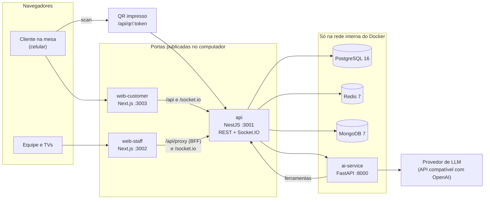

# restauranteSaaS

Sistema para restaurantes em que o cliente faz tudo pelo celular, a partir do QR Code da mesa; a
equipe (recepção, garçons, cozinha, bar e gerência) opera em tempo real; e um assistente de IA ajuda o
cliente a escolher e a pedir.


## Sumário

- [Sobre o projeto](#sobre-o-projeto)
- [O que o sistema faz](#o-que-o-sistema-faz)
- [Arquitetura](#arquitetura)
- [Stack](#stack)
- [Mapa do repositório](#mapa-do-repositório)
- [Como subir e testar](#como-subir-e-testar)
- [Limitação da IA](#limitação-da-ia)
- [Testes automatizados](#testes-automatizados)
- [Limitações conhecidas](#limitações-conhecidas)
- [Documentação](#documentação)
- [Autor e licença](#autor-e-licença)

## Sobre o projeto

Projeto acadêmico desenvolvido de abril a setembro de 2026. É um protótipo funcional que roda
completo em ambiente de desenvolvimento, com Docker; não há deploy público. Um único servidor atende
vários restaurantes, cada um isolado no próprio schema do PostgreSQL (multi-tenant).

## O que o sistema faz

| Quem            | Onde                                 | O que faz                                                                                        |
| --------------- | ------------------------------------ | ------------------------------------------------------------------------------------------------ |
| Cliente na mesa | celular, pelo QR Code                | se identifica, vê o cardápio, pede, chama o garçom, acompanha a conta, conversa com o assistente |
| Recepção        | tablet ou computador (`/host`)       | valida o primeiro scan de cada mesa, libera mesas, fila de espera, reservas                      |
| Garçom          | celular (`/waiter`)                  | chamados, entregas, mesas da sua zona                                                            |
| Cozinha e bar   | tela de preparo (`/cozinha`, `/bar`) | fila de preparo por estação, com versão para TV                                                  |
| Gerente e dono  | `/manager`                           | indicadores, equipe, alertas, mapa do salão, cortesias, configurações                            |

Uma noite típica:

1. O cliente escaneia o QR Code impresso na mesa.
2. A recepção confirma que há alguém sentado ali e aprova a entrada. Isso impede que alguém peça a
   partir da foto de um QR.
3. O primeiro cliente vira o anfitrião da mesa: quem chegar depois é aprovado por ele, no próprio app.
4. O cliente pede pelo cardápio ou pelo assistente, na comanda individual ou na da mesa.
5. O pedido cai no KDS (_kitchen display system_, a tela de preparo) da estação, cozinha ou bar, que
   marca preparo e pronto.
6. O garçom entrega, e o cliente acompanha tudo em tempo real.
7. A conta é dividida no backend, com taxa de serviço e rateio. O pagamento Pix é uma demonstração.

Mais detalhes em [docs/produto/visao-geral.md](docs/produto/visao-geral.md).

## Arquitetura



A API concentra as regras de negócio e o tempo real (Socket.IO). O PostgreSQL guarda os dados
transacionais, com um schema por restaurante; o Redis, sessões e limites de requisição; o MongoDB, o
histórico de conversas e os logs. O serviço de IA interpreta as mensagens do cliente e devolve
intenções, que a API valida de novo antes de executar. Detalhes em
[docs/arquitetura/visao-geral.md](docs/arquitetura/visao-geral.md).

## Stack

| Camada         | Tecnologia                                | Pasta                   |
| -------------- | ----------------------------------------- | ----------------------- |
| App do cliente | Next.js 16, React 18, Tailwind CSS 3      | `apps/web-customer`     |
| App da equipe  | Next.js 16, React 18, Tailwind CSS 3      | `apps/web-staff`        |
| API            | NestJS 11, TypeORM, Socket.IO             | `apps/api`              |
| Serviço de IA  | FastAPI, Python 3.11                      | `services/ai-service`   |
| Dados          | PostgreSQL 16, Redis 7, MongoDB 7         | `packages/database`     |
| Contratos      | TypeScript compartilhado entre API e apps | `packages/shared-types` |
| Monorepo       | npm workspaces, Turborepo                 | raiz                    |
| Infraestrutura | Docker Compose                            | `docker-compose.yml`    |
| Testes         | Jest, pytest, Playwright                  | junto de cada pacote    |

## Mapa do repositório

```text
restauranteSaaS/
├── apps/
│   ├── api/              # backend NestJS (REST + WebSocket), porta 3001
│   ├── web-customer/     # app do cliente na mesa, porta 3003
│   └── web-staff/        # app da equipe e telas de TV, porta 3002
├── services/
│   └── ai-service/       # assistente do cliente (FastAPI + LLM)
├── packages/
│   ├── database/         # migrations, seeds e scripts de tenant
│   └── shared-types/     # tipos compartilhados entre API e apps
├── scripts/
│   ├── audit/            # auditoria de interface no simulador iOS
│   └── demo/             # utilitários de demonstração (resetar mesa, salão cheio)
├── docs/                 # documentação do projeto (comece por docs/README.md)
├── docker-compose.yml    # stack completo de desenvolvimento
└── .env.example          # modelo de configuração
```

Cada app, serviço e pacote tem o próprio `README.md`. Na raiz também há arquivos de configuração de
ferramentas de desenvolvimento (`.ai/`, `.claude/`, `CLAUDE.md`, `AGENTS.md`), que não fazem parte do
produto.

## Como subir e testar

O jeito suportado é o **Docker Compose**: bancos, API, serviço de IA e os dois apps web sobem em
containers. Node e Python na máquina só são necessários para os testes automatizados e para gerar a
imagem do QR no passo 8.

### 1. Pré-requisitos

- Git.
- Docker Desktop (macOS/Windows) ou Docker Engine com o plugin Compose v2 (Linux). Reserve pelo menos
  **12 GB de memória** para o Docker: a API e os dois Next.js em modo de desenvolvimento consomem
  bastante.
- Portas **3001, 3002 e 3003** livres.
- Internet no primeiro boot: o Compose baixa imagens e instala as dependências dentro dos containers,
  o que leva alguns minutos.
- Shell bash ou zsh (macOS ou Linux). No Windows, use o WSL2.
- Opcional: Node.js 20.19 ou mais recente (testes automatizados e o `npx qrcode` do passo 8) e
  Python 3.11 (testes).

| Serviço                | Endereço                           | Observação                             |
| ---------------------- | ---------------------------------- | -------------------------------------- |
| App do cliente         | `http://localhost:3003`            | entra-se pelo QR Code da mesa          |
| App da equipe          | `http://localhost:3002/login`      | recepção, garçom, cozinha, gerência    |
| API                    | `http://localhost:3001/api/health` | também resolve o QR: `/api/qr/<token>` |
| Bancos e serviço de IA | não publicados                     | só na rede interna do Compose          |

### 2. Clonar e criar o `.env`

```bash
git clone <URL-deste-repositório> restauranteSaaS
cd restauranteSaaS
cp .env.example .env
# os dois segredos obrigatórios (o Compose não sobe sem eles)
sed -i.bak "s/^SESSION_TOKEN_SECRET=.*/SESSION_TOKEN_SECRET=$(openssl rand -hex 32)/; s/^STAFF_API_KEY=.*/STAFF_API_KEY=$(openssl rand -hex 32)/" .env && rm .env.bak
```

Sem `openssl`, gere cada valor com `python3 -c "import secrets; print(secrets.token_hex(32))"` e cole
no `.env`. O bloco `LLM_*` pode ficar como está: sem um LLM acessível o sistema funciona, e só a
conversa livre do assistente fica limitada (ver [Limitação da IA](#limitação-da-ia)). Não defina
`POSTGRES_PASSWORD`: a API usa a senha padrão do Compose.

### 3. Criar os volumes e subir o stack

Os volumes de dados são declarados como externos e precisam existir antes do primeiro `up`:

```bash
docker volume create restaurant-saas_postgres_data
docker volume create restaurant-saas_mongodb_data
docker volume create restaurant-saas_redis_data
docker compose up -d --build
```

Espere a API responder:

```bash
curl http://localhost:3001/api/health     # {"status":"ok","service":"api",...}
```

Até o passo 4, o log da API (`docker compose logs api`) mostra erros como
`relation "public.restaurants" does not exist`. É esperado: o banco ainda está vazio.

### 4. Criar o restaurante de demonstração (só na primeira vez)

```bash
# tabelas globais + restaurante "restaurant_dev" com todas as migrations
docker exec restaurant-api sh -c "cd /repo/packages/database && npm run migrate:public && npm run create-tenant -- restaurant_dev --name 'Restaurante Demo'"

# dados de demonstração: mesas, cardápio com fotos, equipe, promoções e 7 dias de histórico
docker compose exec -T postgres psql -U postgres -p 5434 -d restaurant_saas \
  -v ON_ERROR_STOP=1 -c "SET search_path = restaurant_dev" -f /dev/stdin \
  < packages/database/seeds/demo/demo_data.sql
```

O resultado é o restaurante `restaurant_dev` (o _slug_, identificador que vai na URL), com as
mesas **M01 a M05** e duas mesas reservadas aos testes automatizados (**QRTEST91** e **QRTEST92**).

### 5. Credenciais de teste

Todos os dados abaixo são fictícios e vêm do seed. O login da equipe é por CPF e PIN em
`http://localhost:3002/login`; o **PIN de todos é `1234`**.

| Papel         | CPF de login  | Tela inicial |
| ------------- | ------------- | ------------ |
| Recepcionista | `90000000002` | `/host`      |
| Garçom        | `90000000003` | `/waiter`    |
| Cozinha       | `90000000004` | `/cozinha`   |
| Gerente       | `90000000001` | `/manager`   |
| Dono          | `90000000000` | `/manager`   |

- Cada navegador guarda **uma** sessão de equipe. Para ver dois papéis ao mesmo tempo, use perfis de
  navegador diferentes.
- As TVs da cozinha e do bar (`/cozinha/tv`, `/bar/tv`) abrem sem login em desenvolvimento.
- O seed não tem bartender nem caixa com login.

### 6. O QR Code da mesa

O QR impresso em cada mesa aponta para um endereço estável da API, que valida a mesa e redireciona
para o app do cliente com uma assinatura temporária:

```text
http://localhost:3001/api/qr/<qr_public_token-da-mesa>
```

Os tokens das mesas são gerados pelo banco. Para consultá-los:

```bash
docker exec restaurant-postgres psql -U postgres -p 5434 -d restaurant_saas \
  -c "SELECT code, qr_public_token FROM restaurant_dev.tables ORDER BY sort_order;"
```

- Para o teste manual, **use M03, M04 ou M05**: os testes automatizados mexem em M01 e M02.
- No computador não é preciso imprimir nada: basta abrir o endereço no navegador. Para escanear com o
  celular, gere a imagem do QR a partir do endereço em qualquer gerador de QR Code (comando no passo 8).
- Use sempre o endereço `/api/qr/<token>`. O link final para onde ele redireciona expira.

### 7. Roteiro ponta a ponta: QR → recepção → cliente

A recepção tem **cerca de 60 segundos** para decidir cada scan; por isso, abra a recepção antes.

1. **Recepção.** Abra `http://localhost:3002/login` e entre como recepcionista (CPF `90000000002`,
   PIN `1234`). Você cai em `/host`, com os contadores do salão e a lista "Pra liberar".
2. **Cliente.** Em outro perfil do navegador (ou no celular, ver passo 8), abra
   `http://localhost:3001/api/qr/<token-da-mesa>`, com a emulação de celular do DevTools se estiver
   no computador. O app pede **permissão de localização**: permita. Se o navegador tiver
   negado, libere a localização nas configurações do site (ícone à esquerda do endereço) e recarregue;
   se a posição não vier (computador sem serviço de localização), defina uma em DevTools → _Sensors_ →
   _Location_; ou abra pelo IP da rede (passo 8), que dispensa a permissão em desenvolvimento.
3. Na tela **"Pra começar, quem é você?"**, preencha **Seu nome** e **Seu CPF** e toque em
   **Continuar**. O CPF precisa ter dígitos verificadores válidos; use um fictício, como
   `246.813.579-28`, `135.792.468-28` ou `864.209.753-10`. O aparelho mostra **"Esperando aprovação"**.
4. **Aprovar.** Na recepção aparece a seção **"Verificar mesa escaneada"**, com o nome do cliente e o
   CPF mascarado. Clique no cartão: a tela **"Verificar QR"** mostra o tempo restante e a orientação
   de conferir a mesa. Clique em **"Aprovar entrada"**.
5. **Usar o app.** A tela de espera some sozinha e o cliente entra na home da mesa, sem escanear de
   novo. A partir daí:
   - **Ver cardápio** → escolha um prato (o detalhe mostra a foto) → **Adicionar ao pedido** → escolha
     **Minha comanda** ou **Comanda da mesa** → **Revise seu pedido** → **Enviar para cozinha**. Há
     15 segundos para desistir; depois o pedido vai para a cozinha.
   - **Chamar garçom**, escolhendo um dos motivos.
   - **Conta**: abra o menu (ícone no topo) → **Pagar conta**, ou toque em **Ir para pagamento** na tela
     do pedido; o valor aparece por comanda. O Pix é uma demonstração.
6. **O outro lado.** Abra `http://localhost:3002/cozinha/tv`: o pedido aparece como **NOVO PEDIDO**,
   com o botão **INICIAR PREPARO**. Em outros perfis, entre como garçom e como gerente para ver os
   chamados, as entregas e o mapa do salão.

Outros caminhos úteis:

- **Liberar antes de o cliente chegar**: em `/host`, clique em **Liberar** numa mesa livre, escolha
  o número de pessoas e confirme em **Liberar mesa**. Por 15 minutos, o primeiro scan dessa mesa entra
  direto, sem aprovação.
- **Quem chega depois** numa mesa ocupada é aprovado pelo cliente anfitrião, no app dele, e não pela
  recepção.
- **Recomeçar uma mesa**: `bash scripts/demo/reset-mesa.sh M03` encerra a sessão ativa; feche a aba
  do cliente e escaneie de novo.
- **Salão cheio**: o comando abaixo ocupa M01 a M04 com pedidos em vários estágios. Depois disso,
  use a M05 para o fluxo da recepção.

  ```bash
  docker exec -i restaurant-postgres psql -U postgres -p 5434 -d restaurant_saas < scripts/demo/povoar-salao.sql
  ```

- **Voltar ao estado inicial**: rode de novo o segundo comando do passo 4 (o seed). Ele apaga e
  recria mesas, equipe, cardápio e o movimento, inclusive depois dos testes automatizados. Os tokens
  de QR mudam (consulte de novo, passo 6) e a equipe precisa entrar de novo.

### 8. Testar no celular (rede local)

1. Computador e celular na mesma rede Wi-Fi.
2. Descubra o IP do computador (macOS: `ipconfig getifaddr en0`; Linux: `hostname -I`).
3. No `.env`, defina `PUBLIC_HOST=<IP>` e recrie os containers com `docker compose up -d`. Depois de
   recriar, se `/login` ou `/<slug>/mesa/...` responder 404, limpe o cache do Next como em
   [Problemas comuns](#9-problemas-comuns).
4. Gere a imagem do QR com `npx --yes qrcode -o mesa.png "http://<IP>:3001/api/qr/<token>"` e abra
   `mesa.png` na tela para o celular escanear (precisa de Node; sem ele, use qualquer gerador de QR Code
   ou digite o endereço no celular).
5. Aberto pelo IP da rede, sem HTTPS, o app do cliente usa uma localização sintética e não pede
   permissão (`NEXT_PUBLIC_ALLOW_INSECURE_LAN_GEOLOCATION=true`, só em desenvolvimento).
6. A equipe também pode usar tablet ou celular: `http://<IP>:3002/login`.

Se o computador mudar de rede, o IP muda: atualize `PUBLIC_HOST` e recrie os containers (e, se
aparecer 404, limpe o cache do Next).

### 9. Problemas comuns

| Sintoma                                                                | Causa e solução                                                                                                                                                                                                                                                                                                                   |
| ---------------------------------------------------------------------- | --------------------------------------------------------------------------------------------------------------------------------------------------------------------------------------------------------------------------------------------------------------------------------------------------------------------------------- |
| `external volume "restaurant-saas_..." not found`                      | Faltou criar os volumes (passo 3).                                                                                                                                                                                                                                                                                                |
| `SESSION_TOKEN_SECRET must be set` ou `STAFF_API_KEY must be set`      | Faltou preencher os segredos (passo 2).                                                                                                                                                                                                                                                                                           |
| Uma rota que existe responde 404 (ex.: `/login` ou `/<slug>/mesa/...`) | Cache de desenvolvimento do Next.js desatualizado, comum depois de recriar os containers. Limpe e reinicie o app afetado: `docker exec restaurant-web-customer sh -c 'rm -rf /repo/apps/web-customer/.next/*' && docker restart restaurant-web-customer` (para a equipe, troque `web-customer` por `web-staff` nos três lugares). |
| "Conexão lenta. Toque para tentar novamente." no 1º acesso             | A tela espera a API por 3 s, e a primeira compilação do Next demora mais que isso. Toque de novo.                                                                                                                                                                                                                                 |
| "Permita o acesso à localização para entrar no app do restaurante."    | Permissão negada ou posição indisponível. Libere a localização nas configurações do site e recarregue; sem posição, use DevTools → Sensors; ou abra pelo IP da rede (passo 8).                                                                                                                                                    |
| "Mesa nao encontrada." ou restaurante inexistente                      | Faltou o passo 4, ou o endereço usa outro slug ou código de mesa.                                                                                                                                                                                                                                                                 |
| "QR Code invalido ou expirado."                                        | Foi aberto um link final antigo. Abra de novo o endereço `/api/qr/<token>`.                                                                                                                                                                                                                                                       |
| O cartão da recepção não aceita mais a decisão                         | Passou a janela de cerca de 60 s. Aguarde expirar e escaneie de novo, ou use `reset-mesa.sh`.                                                                                                                                                                                                                                     |
| O cliente entrou direto, sem tela de espera                            | A mesa tinha sido liberada pela recepção (15 min).                                                                                                                                                                                                                                                                                |
| O cliente espera e nada aparece na recepção                            | A mesa já estava ocupada: quem aprova é o cliente anfitrião. Use uma mesa livre ou `reset-mesa.sh`.                                                                                                                                                                                                                               |
| API reinicia sozinha ou fica `unhealthy`                               | Pouca memória para o Docker. Use pelo menos 12 GB.                                                                                                                                                                                                                                                                                |
| Muitas tentativas de login                                             | 5 PINs errados para o mesmo CPF bloqueiam o login por 15 minutos.                                                                                                                                                                                                                                                                 |

### 10. Zerar o ambiente

```bash
docker compose down
docker volume rm restaurant-saas_postgres_data restaurant-saas_mongodb_data restaurant-saas_redis_data
```

Isso apaga todos os dados do sistema. Depois, repita os passos 3 e 4.

## Limitação da IA

O assistente do cliente conversa em linguagem natural e executa ações por ele: abrir o cardápio,
adicionar itens, chamar o garçom, abrir a conta. O caminho é **app do cliente → API → serviço de IA →
provedor de LLM**, por uma API compatível com a da OpenAI.

**No ambiente do autor, o LLM rodava localmente no LM Studio, numa máquina com GPU NVIDIA RTX 5090**,
com modelos abertos como Qwen3 Coder 30B e Gemma 4 26B. **Essa máquina não está disponível para quem
for avaliar o projeto.** O sistema sobe e funciona sem ela; só a conversa livre com o assistente fica
limitada.

**Funciona sem LLM**

- Todo o produto fora da conversa livre: QR Code, aprovação pela recepção, cardápio, pedido, comandas,
  chamada de garçom, cozinha, garçom, gerência e o pagamento de demonstração.
- A saudação da home da mesa, que vem de modelos de texto.
- Frases diretas que uma camada de regras resolve sem o LLM, como "quero ver o cardápio", "cadê meu
  pedido?", "chama o garçom" ou "quero pagar a conta". No teste sem LLM, "quero ver o cardápio" foi
  respondida em cerca de 60 ms.

**Não funciona sem LLM**

- Perguntas abertas, comparações, pedidos em linguagem natural e recomendações com restrições
  alimentares além de glúten. O assistente responde **"Desculpe, estou com dificuldade no momento.
  Posso ajudar em breve."** e o resto do app segue normal. No teste, com nada escutando no endereço
  configurado, essa resposta chegou em cerca de 3,5 s. Se o endereço existir mas não responder, a
  espera vai até o tempo limite, e o app do cliente desiste de qualquer requisição após 15 s.

**Como usar outro LLM**

Tudo se configura no `.env`; depois de editar, recrie os serviços com `docker compose up -d`. O próprio
`.env.example` traz os dois blocos prontos.

| Variável                                         | Uso                                                                                         |
| ------------------------------------------------ | ------------------------------------------------------------------------------------------- |
| `LLM_PROVIDER`                                   | `openai` (qualquer API compatível: OpenAI, LM Studio, Ollama), `anthropic` ou `google`      |
| `LLM_BASE_URL`                                   | endereço da API compatível com OpenAI; não deixe vazio, ou o Compose volta para o LM Studio |
| `LLM_API_KEY`                                    | chave do provedor (é a única variável de chave que o código lê)                             |
| `LLM_MODEL_MAIN`, `LLM_MODEL_CLASSIFIER`         | modelo da conversa e modelo do filtro de assunto                                            |
| `LLM_REASONING_EFFORT`                           | `none` para LM Studio; vazio para a API oficial da OpenAI                                   |
| `LLM_COMPACT_PROMPT`, `LLM_COMPACT_TOOL_SCHEMAS` | `true` encurta o prompt para modelos locais de contexto curto                               |
| `LLM_REQUEST_TIMEOUT`, `AI_SERVICE_TIMEOUT_MS`   | tempo máximo do LLM (s) e da API esperando o serviço de IA (ms)                             |

- **LM Studio ou Ollama no próprio computador**: inicie o servidor. O `LLM_BASE_URL` padrão já aponta
  para o LM Studio na porta 1234; para o Ollama, use `LLM_BASE_URL=http://host.docker.internal:11434/v1`.
  No Linux, `host.docker.internal` não existe por padrão: use o IP da máquina. Escolha um modelo
  _instruct_ com suporte a ferramentas e coloque o identificador exato dele em `LLM_MODEL_MAIN` e
  `LLM_MODEL_CLASSIFIER`. O modelo precisa responder bem abaixo de 15 s no seu hardware.
- **API da OpenAI**: use o bloco alternativo do `.env.example` (`LLM_BASE_URL=https://api.openai.com/v1`,
  sua chave, `gpt-4o-mini` e `LLM_REASONING_EFFORT` vazio).
- **Anthropic ou Google**: `LLM_PROVIDER=anthropic` ou `google`, `LLM_API_KEY` e os identificadores dos
  modelos. Esses dois provedores estão implementados, mas não foram validados de ponta a ponta, e não
  usam `LLM_BASE_URL` nem `LLM_REQUEST_TIMEOUT`.

Falhas do LLM aparecem em `docker compose logs ai-service`. Mais detalhes em
[docs/arquitetura/servico-de-ia.md](docs/arquitetura/servico-de-ia.md).

## Testes automatizados

Resultados medidos num ambiente novo, com o stack do tutorial e **sem LLM**:

| Suíte                                | Comando                                                                                                                | Resultado              |
| ------------------------------------ | ---------------------------------------------------------------------------------------------------------------------- | ---------------------- |
| Unitários da API (Jest)              | `npm test --workspace @restaurant/api`                                                                                 | 926 de 926             |
| Unitários do app do cliente (Jest)   | `npm test --workspace @restaurant/web-customer`                                                                        | 180 de 180             |
| Unitários do app da equipe (Jest)    | `npm test --workspace @restaurant/web-staff`                                                                           | 86 de 86               |
| Serviço de IA (pytest, LLM simulado) | `docker exec restaurant-ai sh -c 'pip install -q -r requirements-dev.lock && env -i PATH="$PATH" python -m pytest -q'` | 435 de 435             |
| Ponta a ponta (Playwright, WebKit)   | `cd apps/web-customer && npx playwright install webkit && npx playwright test`                                         | 99 de 142 (ver abaixo) |

Os unitários rodam no host depois de um `npm install` na raiz e não precisam do stack. O pytest roda
dentro do container com o ambiente limpo (`env -i`), porque as variáveis do Compose interferem nos
testes.

A suíte ponta a ponta precisa do stack no ar com o seed, roda em série e mexe nas mesas M01, M02,
QRTEST91 e QRTEST92; por isso, rode-a **depois** do roteiro manual e, ao terminar, volte ao estado
inicial com o seed (segundo comando do passo 4). Das 43 execuções que não passam:

- 1 depende de um LLM de verdade, por definição ("pergunta aberta usa o LLM real"); o teste seguinte
  do mesmo arquivo, em série, não chega a rodar.
- 26 estão nos três specs de TV (`tv-kds`, `tv-coverage`, `tv-delivery-flow`), escritos para o modelo
  de autenticação anterior: a maioria das chamadas recebe 401, porque a API hoje exige o token
  derivado da sessão do cliente e a sessão individual da equipe.
- 5 esperam um botão "Fechar" nas folhas de chamar garçom e de cardápio, que a interface atual não
  tem. As folhas funcionam; o seletor do teste ficou desatualizado.
- 1 (`physical-qr-heavy`, cenário 9) espera um evento de socket do garçom que não chega no fim da
  escalada da verificação do QR; os 9 cenários seguintes do arquivo, em série, não chegam a rodar.

Detalhes, variáveis e a cobertura de cada spec em
[docs/desenvolvimento/testes.md](docs/desenvolvimento/testes.md).

## Limitações conhecidas

- **Pix de demonstração**: não há provedor de pagamento integrado; o fluxo é simulado.
- **Login do cliente só por CPF**: é um risco aceito e temporário. A correção prevista é confirmação em
  canal verificado ou presencial ([ADR 0006](docs/decisoes/0006-aceitar-login-do-cliente-so-por-cpf-temporariamente.md)).
- **Notificações push** sem provedor configurado.
- **Caixa** (`/cashier`) sem liquidação.
- O seed não tem bartender nem caixa com login.
- Sem deploy público: o projeto roda em ambiente de desenvolvimento.

A lista completa, com os riscos aceitos, está em
[docs/seguranca/riscos-aceitos-e-pendencias.md](docs/seguranca/riscos-aceitos-e-pendencias.md).

## Documentação

Comece por [docs/README.md](docs/README.md). Os atalhos principais:

- [Produto](docs/produto/visao-geral.md): o que o sistema faz, jornadas e telas, funcionalidades.
- [Arquitetura](docs/arquitetura/visao-geral.md): containers, dados, autenticação, tempo real, pedido e IA.
- [Decisões (ADRs)](docs/decisoes/README.md): o porquê das escolhas de produto e de engenharia.
- [Desenvolvimento](docs/desenvolvimento/ambiente-local.md): ambiente local em detalhe, testes e convenções.
- [Segurança](docs/seguranca/modelo-de-seguranca.md): modelo de segurança e riscos aceitos.
- [Design](docs/design/README.md): o canvas V20, referência visual das telas.

## Autor e licença

Desenvolvido por Caleb Medeiros.

Todos os direitos reservados. O acesso a este repositório foi concedido exclusivamente para avaliação
acadêmica; não é permitido copiar, distribuir ou usar o código para outros fins sem autorização do
autor. Ver [LICENSE](LICENSE).
