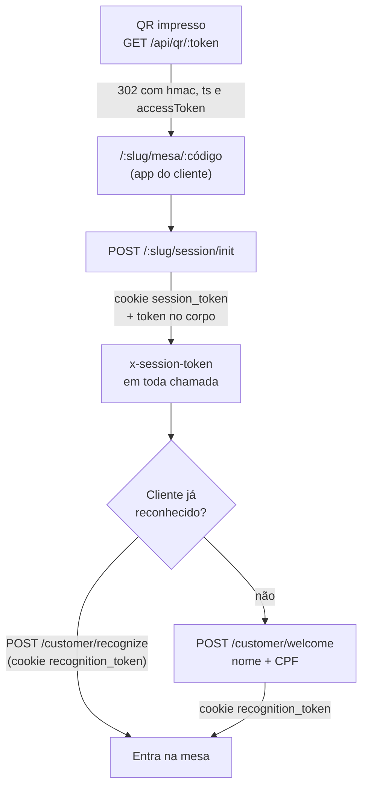

# Autenticação e sessões

Quatro tipos de chamador falam com a API, cada um com a sua credencial. A visão de segurança (o que
isso protege e o que não protege) está em [Modelo de segurança](../seguranca/modelo-de-seguranca.md).

| Chamador                        | Credencial                                                         | Onde fica no navegador                                    | Validade |
| ------------------------------- | ------------------------------------------------------------------ | --------------------------------------------------------- | -------- |
| Mesa (qualquer cliente sentado) | Token da sessão de mesa, `x-session-token`                         | `sessionStorage` e cookie httpOnly `session_token`        | 4 h      |
| Cliente identificado            | Cookie httpOnly `recognition_token`                                | só no cookie                                              | 365 dias |
| Equipe                          | Token opaco de sessão                                              | cookie httpOnly `staff_token`, lido só pelo servidor Next | 12 h     |
| TV                              | PIN da TV                                                          | cookie httpOnly `tv_pin`                                  | 12 h     |
| Serviço de IA ↔ API             | `X-AI-Service-Key` (API → IA); token da mesa do cliente (IA → API) | não passa pelo navegador                                  | —        |

## Cliente

1. **QR.** `GET /api/qr/:token` procura `tables.qr_public_token` nos restaurantes ativos e redireciona
   para o app do cliente com três parâmetros: `hmac` (HMAC-SHA256 com o segredo da mesa, válido por
   30 min), `ts` e `accessToken` (válido só no dia UTC corrente)
   (`apps/api/src/modules/qr-resolver/`, `table-session/qr-code.service.ts`). O app apaga esses
   parâmetros do histórico do navegador depois de usá-los.
2. **Sessão de mesa.** `POST /api/:slug/session/init` (público) confere mesa ativa, `hmac` e
   `accessToken`, reaproveita a sessão ativa da mesa ou cria uma. O token da mesa é
   **HMAC-SHA256(`SESSION_TOKEN_SECRET`, id da sessão)** (`apps/api/src/common/auth/session-auth-token.ts`);
   o Redis guarda `session:<token>` com mesa e schema por 4 h. O id da sessão não é credencial
   ([ADR 0007](../decisoes/0007-proteger-sessoes-com-token-derivado-e-bff-da-equipe.md)).
3. **Uso.** O app manda `x-session-token` em toda chamada (`apps/web-customer/src/lib/api.ts`), porque
   o cookie `SameSite=Lax` não acompanha chamadas entre origens diferentes. O `SessionGuard` aceita o
   cookie ou o cabeçalho, busca a sessão no Redis e confere no banco que o schema do token é o da URL e
   que a sessão continua ativa (`common/guards/session-revalidation.ts`).
4. **Identidade.** `POST /api/:slug/customer/welcome` (nome e CPF) e `POST
/api/:slug/customer/recognize` emitem o cookie httpOnly `recognition_token`, nunca no corpo. `POST
/api/:slug/customer/identify` (público, 5 tentativas por IP a cada 15 min) serve às telas pessoais
   de quem já está sentado. Com CPF já cadastrado, o `welcome` e o `identify` entram no perfil
   existente: exceção aceita temporariamente
   ([ADR 0006](../decisoes/0006-aceitar-login-do-cliente-so-por-cpf-temporariamente.md)).
5. **Quem é o cliente.** O `CallerResolverService` (`common/services/caller-resolver.service.ts`)
   resolve o cliente pelo `recognition_token`. O `customerId` guardado na sessão de mesa é
   compartilhado por todos da mesa e nunca autoriza dado pessoal.
6. **Saída.** `POST /api/:slug/customer/logout` apaga os dois cookies e troca o `recognition_token`.
   A varredura periódica fecha a sessão de mesa parada há 4 h e apaga a chave dela no Redis.

## Equipe

1. **Login.** A tela `/login` do app da equipe chama `POST /api/proxy/<slug>/staff-auth/login` com
   CPF e PIN. O slug vem de `NEXT_PUBLIC_TENANT_SLUG` (padrão `restaurant_dev`). A API
   (`apps/api/src/modules/staff-auth/staff-auth.service.ts`) confere o PIN (bcrypt; hash antigo
   SHA-256 é trocado no primeiro login), aplica o bloqueio por tentativas e cria um token opaco de 32
   bytes. O Redis guarda só os dados da sessão (funcionário, papel, slug, validade), indexados pela
   hash do token (`common/auth/staff-session-token.ts`).
2. **BFF.** O proxy do Next (`apps/web-staff/src/app/api/proxy/[...path]/route.ts`) tira o token da
   resposta e o grava no cookie httpOnly `staff_token`. Daí em diante, toda chamada do app vai para
   `/api/proxy/...`; o proxy acrescenta `x-staff-token` (do cookie) e `x-staff-key` (a
   `STAFF_API_KEY`, que só existe no servidor) e repassa à API. Sem cookie, o proxy responde 401 sem
   chamar a API. Nenhuma chave vai para o código do navegador.
3. **`StaffOnlyGuard`** (`common/guards/staff-only.guard.ts`) aceita:
   - `x-staff-token` válido e do mesmo restaurante; um token presente e inválido dá 403, sem tentar a
     chave; token marcado para troca de PIN dá 403 `AUTH_PIN_CHANGE_REQUIRED`; ou
   - `x-staff-key` igual à `STAFF_API_KEY` (comparação em tempo constante), usada pelo proxy e pelas TVs.
4. **Papel.** `ManagerOnlyGuard`, `HostOrManagerGuard`, `KitchenOrManagerGuard` e `OwnerOnlyGuard`
   preferem a identidade do token e reconferem o papel no banco. O cabeçalho antigo `x-staff-id` só
   é aceito quando o token não é obrigatório: fora de produção, staging e preview, e com
   `STAFF_SESSION_REQUIRED` diferente de `true` (`common/guards/staff-auth-context.ts`).
5. **Destino por papel** (`homeForStaffRole`): dono e gerente → `/manager`; recepção → `/host`;
   garçom → `/waiter`; cozinha → `/cozinha`; bar → `/bar`; caixa → `/cashier`. PIN temporário leva a
   `/trocar-pin`.
6. **Revogação.** Troca e redefinição de PIN e logout apagam as sessões do funcionário no Redis. O
   gerente vê e encerra as próprias sessões em `/manager/seguranca`.
7. **Recuperação de PIN** (`/forgot`): código de 6 dígitos → token de redefinição → PIN novo, com
   limite próprio de tentativas. Nenhum código envia o código por SMS ou e-mail: fora de produção a
   resposta traz o código (`devCode`) para teste; em produção, sem
   `STAFF_RECOVERY_DELIVERY_ENABLED=true`, a rota responde 503 e orienta procurar um gerente.

O desenho que levou à sessão no servidor está arquivado em
[2026-07-design-sessao-staff-server-side.md](../archive/2026-07-design-sessao-staff-server-side.md);
o código atual é a referência.

## TVs

`/cozinha/tv` e `/bar/tv` não têm login. O `src/proxy.ts` do app da equipe redireciona para
`/cozinha/unlock` quando o cookie `tv_pin` não confere com `TV_ACCESS_PIN`. `POST /api/tv-unlock`
compara o PIN em tempo constante, com limite de tentativas, e grava o cookie por 12 h. As chamadas das
TVs à API passam pelo proxy, que injeta a `STAFF_API_KEY`. Sem `TV_ACCESS_PIN`, as TVs abrem sem PIN
em desenvolvimento e ficam bloqueadas em produção e staging.

O KDS individual do bar (`/bar`) e da cozinha (`/cozinha`) usa o login normal do funcionário.

## API e serviço de IA

- **API → IA.** Toda chamada leva `X-AI-Service-Key` com o valor de `AI_SERVICE_API_KEY`
  (`apps/api/src/infra/ai/ai-service.client.ts`). O serviço de IA recusa chamadas sem a chave, exceto
  em `/health` e na documentação da API. Sem a variável configurada, recusa tudo em produção e staging
  e aceita com aviso em desenvolvimento.
- **IA → API.** As ferramentas do assistente chamam a API com o `x-session-token` da mesa do cliente
  que está conversando. A API aplica as mesmas regras de uma chamada do app. A rota interna
  `/tools/dispatch` do serviço de IA recusa pedidos de ferramenta de equipe.

## WebSocket

O handshake aceita o cookie `staff_token`, a chave de serviço (TVs) ou o token da mesa, com limite
de 30 handshakes por minuto por IP. Detalhes em [Tempo real](tempo-real.md).

## Variáveis envolvidas

| Variável                    | Quem lê                                    | Papel                                                                |
| --------------------------- | ------------------------------------------ | -------------------------------------------------------------------- |
| `SESSION_TOKEN_SECRET`      | API                                        | Chave do HMAC do token da mesa; obrigatória no compose e em produção |
| `STAFF_API_KEY`             | API, proxy do app da equipe, serviço de IA | Chave de serviço; obrigatória no compose e em produção               |
| `STAFF_SESSION_TTL_SECONDS` | API                                        | Validade da sessão da equipe (padrão 12 h)                           |
| `STAFF_SESSION_REQUIRED`    | API                                        | `true` exige o token individual também em desenvolvimento            |
| `TV_ACCESS_PIN`             | app da equipe (servidor)                   | PIN das TVs                                                          |
| `AI_SERVICE_API_KEY`        | API e serviço de IA                        | Chave entre os dois                                                  |
| `CUSTOMER_WELCOME_RATE_*`   | API                                        | Limite do `welcome`                                                  |

Lista completa: [Ambiente local](../desenvolvimento/ambiente-local.md).
