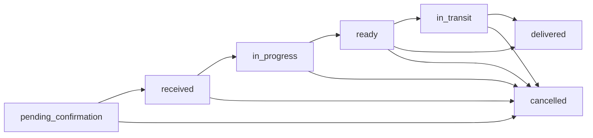

# Ciclo do pedido

Do carrinho do cliente até a entrega na mesa. Código principal em `apps/api/src/modules/orders/`.

## Máquina de estados

A fonte é `apps/api/src/modules/orders/order-state-machine.ts` (`VALID_TRANSITIONS`):

| Estado                 | Significado                                            | Quem leva até ele                                               |
| ---------------------- | ------------------------------------------------------ | --------------------------------------------------------------- |
| `pending_confirmation` | Pedido recém-enviado pelo cliente; ainda pode desistir | Cliente (`POST /:slug/orders`)                                  |
| `received`             | Confirmado; aparece na fila da cozinha e do bar        | Cliente (`PATCH /orders/:id/confirm`) ou confirmação automática |
| `in_progress`          | Alguma estação começou a preparar                      | Cozinha ou bar                                                  |
| `ready`                | Todos os itens prontos                                 | Cozinha ou bar                                                  |
| `in_transit`           | Um garçom está levando                                 | Garçom ("Estou levando")                                        |
| `delivered`            | Entregue na mesa. Final                                | Garçom ("Confirmar entrega")                                    |
| `cancelled`            | Cancelado. Final                                       | Cliente (só na janela), equipe                                  |

Regras:

- `open`, `confirmed` e `preparing` são nomes antigos aceitos como sinônimos; pedido novo sempre
  usa os nomes canônicos.
- O cliente só pode **cancelar**, e só a partir de `pending_confirmation` (ou `open`), e só pedido da
  própria mesa (`CUSTOMER_CANCELLABLE_STATUSES`). As demais mudanças são da equipe.
- Repetir a transição para o estado atual não faz nada (idempotente). Cada mudança fica em
  `order_status_history`.
- O pedido direto do garçom (`POST /:slug/orders/staff-direct`) já nasce `received`.
- A criação aceita chave de idempotência: reenviar o mesmo carrinho não cria pedido duplicado
  (migrations 075 e 076).

## Janela de 15 s para desistir

O pedido do cliente nasce com `auto_confirm_at = agora + 15 s` (`PENDING_CONFIRMATION_WINDOW_SECONDS`
em `orders.service.ts`). Nesse intervalo o cliente confirma, cancela ou espera. A confirmação
automática não é uma tarefa agendada: roda quando alguma tela lista pedidos (as TVs consultam a fila
o tempo todo), no máximo uma vez a cada 5 s por restaurante (chave `sweep:auto-confirm:<slug>` no
Redis). Também pode ser disparada por `POST /:slug/orders/_sweep-auto-confirm` (equipe).

## Itens por estação

A cozinha e o bar trabalham nos **itens**, não no pedido inteiro:

- a estação de um item vem de `menu_items.kind`: `drink` vai para o bar; qualquer outro valor, para
  a cozinha. Nunca pelo nome da categoria;
- cada estação avança os próprios itens em `order_items.status` (`received → in_progress → ready`),
  pela mesma rota de status com o parâmetro de estação (migration 071);
- ao entrar em `in_progress`, o item recebe `prep_started_at` (migration 078). É o relógio do preparo;
- o status do pedido é reconciliado a partir de todos os itens: vira `ready` só quando **todos** estão
  prontos, e `in_progress` assim que algum começou;
- o `UPDATE` dos itens usa o mesmo parâmetro no `SET` e num `CASE`, por isso leva o cast
  `$1::varchar`. Sem ele, o PostgreSQL responde erro 42P08 (os testes com banco simulado não pegam
  isso).

O KDS individual (`/cozinha` para `cook`, `/bar` para `bartender`) e as TVs (`/cozinha/tv`,
`/bar/tv`) leem `GET /:slug/orders/_kds` filtrado pela estação (`kds-query.service.ts`).

## Prioridade na fila

`kds-query.service.ts` ordena em três faixas e, dentro de cada uma, por ordem de chegada:

1. **urgência**: o gerente puxou o pedido para a frente (`orders.priority_rank > 0`, rota `POST
/:slug/kitchen/reorder`);
2. **VIP**: sessão marcada como VIP ou cliente com `customers.is_vip`
   ([Cliente VIP](../produto/funcionalidades/cliente-vip.md));
3. **normal**.

## ETA mostrada ao cliente

`eta-engine.ts` calcula um intervalo em minutos por estágio; `eta-decorator.service.ts` aplica ao
pedido:

| Estágio                                      | Intervalo                                             |
| -------------------------------------------- | ----------------------------------------------------- |
| na fila (`pending_confirmation`, `received`) | a base configurada pela cozinha, mais a fila à frente |
| `in_progress`                                | metade da base                                        |
| `ready`                                      | 2 a 5 min                                             |
| `in_transit`                                 | 1 a 3 min                                             |

- A **base** vem de `settings.kitchen_eta_min_minutes` e `kitchen_eta_max_minutes` (migration 056),
  que a cozinha ajusta em `/cozinha/eu`. Sem configuração, vale 10 a 16 min.
- A **fila à frente** conta o trabalho dos pedidos que vêm antes (respeitando as faixas de
  prioridade) em 2 linhas paralelas: cada vaga soma 4 a 7 min. Esses coeficientes ainda são
  heurística fixa no código.

## Pedidos atrasados

O painel do gerente (`apps/api/src/modules/dashboard/dashboard.service.ts`, campo `lateOrders`) lista
pedidos atrasados **só da cozinha**, porque ainda não existe meta configurável para o bar:

- considera itens que não são bebida, em `in_progress` e com `prep_started_at`;
- o atraso é contado desde o `prep_started_at` mais antigo do pedido, nunca de `orders.updated_at`;
- a meta é `settings.kitchen_eta_max_minutes`, e o próprio item da lista carrega `targetMinutes`. Sem
  meta configurada, a lista fica vazia. O seed de demonstração não configura essa meta.

O mapa, as telas e a carga dos garçons usam essa mesma definição.

## Entrega e garçom

1. **Chamar garçom.** Com o pedido `ready`, a cozinha, o bar ou a TV tocam "Chamar garçom" (`POST
/:slug/orders/:orderId/call-waiter`). A API escolhe o garçom (`resolveTargetWaiter` em
   `order-delivery.service.ts`), nesta ordem:
   1. garçons atribuídos hoje à zona da mesa, ativos, em turno agora e sem pausa; entre eles, o
      acionado há mais tempo (rodízio);
   2. o último garçom que atendeu um chamado dessa mesa, se não estiver em pausa;
   3. garçons em turno agora, sem pausa, pelo rodízio;
   4. qualquer garçom ativo sem pausa, por nome.

   Nenhuma etapa escolhe garçom em pausa ([Pausa de zona](../produto/funcionalidades/pausa-de-zona.md)).
   O horário de turno usa o fuso do restaurante (`settings.timezone`), inclusive turnos que passam da
   meia-noite.

2. **Estou levando.** O garçom assume a entrega (`POST /:slug/orders/:orderId/in-transit`). Outro
   garçom pode assumir no lugar.
3. **Confirmar entrega.** `POST /:slug/orders/:orderId/delivered`. Só então o cliente vê o pedido como
   entregue, e a API cria a avaliação pendente do pedido
   ([Avaliação e reclamação](../produto/funcionalidades/avaliacao-e-reclamacao.md)).

A mesa tem no máximo um chamado de garçom ativo por vez (índice único, migration 057).

## Carga dos garçons

`GET /:slug/dashboard/team-kpis` devolve `waiterWorkload` (`waiter-workload.service.ts`), usado pelo
mapa e pelas telas de equipe do gerente:

- cada sessão ativa é atribuída **uma única vez** a um garçom, escolhido entre os candidatos da zona,
  do turno e sem pausa, pelo mesmo rodízio. Não se multiplica a mesa por todos os garçons da zona;
- a pontuação soma pesos explícitos por mesa, pessoa, pedido ativo, pedido atrasado, chamado pendente
  e entrega pendente (`WAITER_WORKLOAD_WEIGHTS`);
- um desequilíbrio gera um único alerta `manager_staff_workload_imbalance`, com intervalo de 15 min
  entre alertas, visível só para gerente e dono.

## Referências de código

- `apps/api/src/modules/orders/` (`order-state-machine.ts`, `orders.service.ts`,
  `kds-query.service.ts`, `eta-engine.ts`, `eta-decorator.service.ts`, `order-delivery.service.ts`)
- `apps/api/src/modules/dashboard/` (`dashboard.service.ts`, `waiter-workload.service.ts`)
- Migrations `016`, `056`, `057`, `060`, `071`, `075`, `076` e `078` em
  `packages/database/migrations/tenant-template/`
- Eventos: [Tempo real](tempo-real.md)
