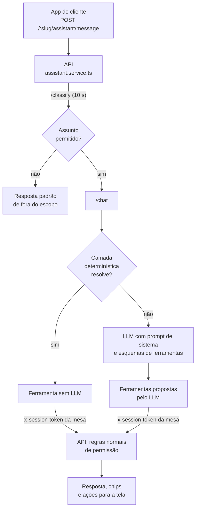

# Serviço de IA

O assistente do cliente (`/[slug]/assistente`) conversa em português, responde sobre o cardápio e
executa ações pelo cliente: abrir o cardápio, adicionar item ao pedido, chamar o garçom, abrir a
conta. Ele roda num serviço próprio, `services/ai-service` (Python 3.11 + FastAPI), separado da API
([ADR 0003](../decisoes/0003-separar-o-servico-de-ia-e-responder-sem-llm-quando-possivel.md)). O app
da equipe não usa LLM.

## Endpoints (`services/ai-service/main.py`)

| Rota                                      | O que faz                                                                     | Usa LLM?                                   |
| ----------------------------------------- | ----------------------------------------------------------------------------- | ------------------------------------------ |
| `GET /health`                             | Provedor e modelos configurados, número de ferramentas. Não consulta o LLM    | não                                        |
| `POST /classify`                          | Filtro de assunto (o que é conversa de restaurante)                           | só na última camada                        |
| `POST /chat`                              | Resposta do assistente, com ferramentas                                       | só se a camada determinística não resolver |
| `POST /continuation`, `GET /continuation` | Mensagem de boas-vindas da home e do assistente, a partir de modelos de texto | não                                        |
| `POST /smart-suggestions`                 | Chips de sugestão de um conjunto fixo                                         | não                                        |
| `POST /tools/dispatch`, `GET /tools`      | Executa ou lista ferramentas sem LLM. Recusa ferramenta de equipe             | não                                        |

Toda rota, menos `/health` e a documentação da API, exige `X-AI-Service-Key` igual a
`AI_SERVICE_API_KEY`. Sem a variável, o serviço recusa tudo em produção e staging e aceita com aviso
em desenvolvimento. O serviço não publica porta: só a API o alcança, pela rede interna.

## Fluxo de uma mensagem

1. A API recebe a mensagem, aplica o limite de 50 mensagens por sessão de mesa e responde saudações
   simples sem chamar o serviço de IA.
2. **Filtro de assunto** (`/classify`): saudação e confirmações curtas → expressões regulares de temas
   bloqueados (política, religião, código, medicina, etc.) → lista de intenções permitidas → frase curta
   com histórico → só então o LLM classificador. Se o LLM falhar, o filtro **deixa passar**. A API
   espera no máximo 10 s e, se não houver resposta, também deixa passar.
3. **Chat** (`/chat`): primeiro a camada determinística; o LLM só recebe o que ela não resolveu, com
   `max_tokens=500`, as 10 mensagens mais recentes e os esquemas de ferramentas.
4. As ferramentas chamam a API com o `x-session-token` da mesa do cliente. Para a API, é o mesmo que
   uma chamada do app: a ferramenta expressa uma **intenção**, e a API decide se ela vale.
5. `services/response_validator.py` troca respostas fora de escopo por um texto padrão.

## Camada determinística

Resolve sem LLM (`main.py`, funções `_rule_tool_response` e vizinhas; bateria em
`tests/test_rule_layer_phrases.py`):

- decisão do cliente-anfitrião sobre quem pediu para entrar na mesa ("pode entrar", "agora não");
- confirmações curtas ("ok", "obrigado");
- quem pergunta como entrar numa mesa ocupada recebe a orientação de escanear o QR da mesa;
- situação de um pedido de junção de mesas;
- status do pedido e "ver meu pedido";
- pagamento: abrir a conta, dividir, pagar a parte, pagar tudo;
- "tem opções sem glúten?" (a API filtra pelos alérgenos declarados);
- mensagem para o gerente;
- frases diretas curtas (até 6 palavras, sem negação): ver o cardápio, pedir uma recomendação,
  chamar o garçom, ver a cortesia, falar com o gerente.

Recomendação com qualquer outra restrição alimentar ("sem camarão", "sou vegano") **não** passa por
essa camada: vai para o LLM, que recebe os alérgenos de cada item no prompt de sistema.

## Ferramentas

`services/ai-service/services/tools/__init__.py` registra **40** ferramentas: 31 do cliente e 9 da
equipe. **26** são anunciadas ao LLM (`CANONICAL_TOOL_NAMES`); as outras 5 do cliente ficam por
compatibilidade. As 9 de equipe não têm superfície: nenhum app as chama e o `/tools/dispatch` as
recusa.

Regras que valem para todas:

- **Chips canônicos.** As ferramentas que mudam algo devolvem sempre os chips da próxima ação,
  definidos no serviço, e não inventados pelo LLM. O teste
  `test_tools_registry.py::test_chips_coverage_at_least_9_of_10_mutations` exige cobertura de pelo
  menos 9 em cada 10 ferramentas de mudança.
- **Item do pedido por nome só sem ambiguidade.** `add_to_order` resolve o item pelo nome digitado
  apenas quando há um único candidato claro; se houver dúvida, pede escolha em vez de adivinhar
  (commit `71006c1`, testes em `tests/test_add_to_order_name_resolution.py`).
- **Confirmação.** Ferramentas propostas pelo LLM têm origem marcada como não confiável; uma
  confirmação que o próprio LLM tente incluir é removida.

## O que o LLM nunca decide

| Decisão                                        | Quem decide                                                                                                                                                                                                                                                                             |
| ---------------------------------------------- | --------------------------------------------------------------------------------------------------------------------------------------------------------------------------------------------------------------------------------------------------------------------------------------- |
| Deixar alguém entrar na mesa                   | Frase literal do cliente-anfitrião (comparação determinística antes do LLM) ou o toque dele no app. Qualquer proposta do LLM para aceitar ou recusar é descartada (`_llm_may_decide_join`)                                                                                              |
| Recomendação para quem tem restrição alimentar | Com restrição de glúten, a lista é refeita pela API a partir dos alérgenos declarados; o texto do LLM não vale. Sem opção aprovada pelo filtro, a resposta diz isso e sugere chamar o garçom (`enrichRecommendationToolCalls` em `apps/api/src/modules/assistant/assistant.service.ts`) |
| Excluir dados pessoais                         | Só o botão do app ([Histórico de chat e LGPD](../produto/funcionalidades/historico-de-chat-e-lgpd.md))                                                                                                                                                                                  |

Nomes e dados do cardápio entram no prompt de sistema como dado literal, com marcas de instrução
neutralizadas, para que texto controlado por usuários não vire instrução.

## Continuação da home

A mensagem de boas-vindas da home e do assistente **não usa LLM**. A API deriva o tipo de momento
(chegou agora, pediu, pagou, voltou…) do estado no banco e pede ao serviço um modelo de texto desse
tipo (`services/ai-service/services/continuation.py`). Slot obrigatório ausente troca o modelo por
um texto genérico. Os conjuntos de modelos ficam no Redis ou, no stack do compose, na memória do
processo. Com `HOME_CONTINUATION_ENABLED=false`, a home mostra só os dois botões fixos.

## Provedores

`LLM_PROVIDER` escolhe a implementação (`services/ai-service/services/llm/factory.py`), criada só no
primeiro uso, então o serviço sobe mesmo sem LLM acessível:

| Provedor    | Uso                                                              | Lê `LLM_BASE_URL` | Lê `LLM_REQUEST_TIMEOUT` e `LLM_REASONING_EFFORT` |
| ----------- | ---------------------------------------------------------------- | ----------------- | ------------------------------------------------- |
| `openai`    | API da OpenAI e qualquer servidor compatível (LM Studio, Ollama) | sim               | sim                                               |
| `anthropic` | API da Anthropic                                                 | não               | não                                               |
| `google`    | API do Google Gemini                                             | não               | não                                               |

A chave de todos é **`LLM_API_KEY`**. `OPENAI_API_KEY`, `ANTHROPIC_API_KEY` e `GOOGLE_API_KEY` são
repassadas pelo compose, mas nenhum código as lê.

O caminho validado é o `openai` apontando para um LM Studio. Os provedores `anthropic` e `google`
convertem as ferramentas para o formato de cada API, mas não foram validados ponta a ponta
`[NÃO VERIFICADO]`.

## Configuração

| Variável                                         | Padrão no compose                              | Observação                                                                                                                                                          |
| ------------------------------------------------ | ---------------------------------------------- | ------------------------------------------------------------------------------------------------------------------------------------------------------------------- |
| `LLM_PROVIDER`                                   | `openai`                                       |                                                                                                                                                                     |
| `LLM_BASE_URL`                                   | LM Studio no computador hospedeiro, porta 1234 | O compose usa `${VAR:-padrão}`: deixar vazio **não** leva à API oficial da OpenAI, volta para o LM Studio. Para a OpenAI, preencha o endereço                       |
| `LLM_API_KEY`                                    | valor de exemplo do LM Studio                  |                                                                                                                                                                     |
| `LLM_MODEL_MAIN`, `LLM_MODEL_CLASSIFIER`         | modelo instruct de 7B para Apple Silicon       | Conversa e filtro de assunto                                                                                                                                        |
| `LLM_REASONING_EFFORT`                           | `none`                                         | O compose usa `${LLM_REASONING_EFFORT-none}`: vazio é respeitado (o necessário para a API oficial da OpenAI); `none` só vale quando a variável não existe no `.env` |
| `LLM_REQUEST_TIMEOUT`                            | 90 s                                           | Só no provedor `openai`                                                                                                                                             |
| `LLM_COMPACT_PROMPT`, `LLM_COMPACT_TOOL_SCHEMAS` | `true`                                         | Encurtam instruções e esquemas para modelos locais                                                                                                                  |
| `AI_SERVICE_TIMEOUT_MS`                          | 95000                                          | Quanto a API espera o `/chat` (padrão do código: 35000)                                                                                                             |
| `AI_SERVICE_API_KEY`                             | valor de desenvolvimento                       | Chave entre API e serviço                                                                                                                                           |
| `HOME_CONTINUATION_ENABLED`                      | `true`                                         | `false` no `.env.example`: a home mostra os botões canônicos em vez das sugestões                                                                                   |

O `.env.example` traz esses mesmos padrões (exceto `HOME_CONTINUATION_ENABLED=false`) e um bloco alternativo para a API da OpenAI. Passo a passo
em [Ambiente local](../desenvolvimento/ambiente-local.md).

## Tempos

| Camada                | Limite                                                                          |
| --------------------- | ------------------------------------------------------------------------------- |
| App do cliente        | desiste de qualquer requisição em 15 s (`apps/web-customer/src/lib/api.ts`)     |
| API → `/classify`     | 10 s, depois deixa passar                                                       |
| API → `/chat`         | `AI_SERVICE_TIMEOUT_MS`                                                         |
| Serviço → LLM         | `LLM_REQUEST_TIMEOUT` (provedor `openai`)                                       |
| API → `/continuation` | 0,8 s na home e 1,5 s na rota de continuação; falha deixa a home sem a mensagem |

Como o app desiste em 15 s, um LLM que leva mais que isso não serve para o assistente, mesmo que a
API ainda espere.

## Sem LLM

O restante do sistema não depende do LLM: QR, recepção, cardápio, pedido, cozinha, garçom, gerente e
pagamento de demonstração funcionam normalmente, e também a camada determinística, a continuação e
os chips.

Quando o LLM não responde, o `/chat` devolve 503 e a API responde ao cliente, com HTTP 201:
"Desculpe, estou com dificuldade no momento. Posso ajudar em breve.", com chips de sugestão
(`FALLBACK_RESPONSE` em `assistant.service.ts`). O app não quebra.

Quanto demora a falha depende do tipo de problema. Com a conexão recusada (nada escutando no
endereço configurado), a resposta de fallback chegou ao cliente em cerca de 3,5 s no ensaio, já
contando as novas tentativas do cliente OpenAI. Um endereço que não responde segura a chamada até
o limite de tempo, e o app do cliente desiste antes, em 15 s (`apps/web-customer/src/lib/api.ts`).

Para conferir: `GET /health` no container `restaurant-ai` mostra provedor e modelos; falhas do LLM
aparecem no log do serviço como `LLM chat failed`.

## Referências de código

- `services/ai-service/main.py`, `config.py`, `services/llm/`, `services/tools/`,
  `services/continuation.py`, `services/blocked_patterns.py`, `services/response_validator.py`
- `apps/api/src/modules/assistant/assistant.service.ts`, `apps/api/src/infra/ai/ai-service.client.ts`
- Testes: `services/ai-service/tests/` (pytest)
