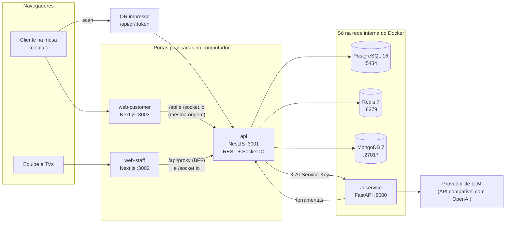

# Arquitetura: visão geral

O sistema é um monorepo com dois apps web, uma API, um serviço de IA e três bancos, todos subindo
juntos pelo `docker-compose.yml` da raiz. Esta página é o mapa; cada tema tem página própria nesta
pasta.

## Diagrama

## Containers e portas

| Serviço (container)                        | Tecnologia                                                               | Porta | Exposição       |
| ------------------------------------------ | ------------------------------------------------------------------------ | ----- | --------------- |
| `api` (`restaurant-api`)                   | NestJS 11 em `node:20-alpine`, código montado do repositório             | 3001  | publicada       |
| `web-customer` (`restaurant-web-customer`) | Next.js 16 + React 18                                                    | 3003  | publicada       |
| `web-staff` (`restaurant-web-staff`)       | Next.js 16 + React 18                                                    | 3002  | publicada       |
| `ai-service` (`restaurant-ai`)             | Python 3.11 + FastAPI, imagem própria (`services/ai-service/Dockerfile`) | 8000  | só rede interna |
| `postgres` (`restaurant-postgres`)         | PostgreSQL 16                                                            | 5434  | só rede interna |
| `redis` (`restaurant-redis`)               | Redis 7                                                                  | 6379  | só rede interna |
| `mongodb` (`restaurant-mongodb`)           | MongoDB 7                                                                | 27017 | só rede interna |

Os bancos não publicam porta de propósito (comentário no topo do `docker-compose.yml`): o acesso de
desenvolvimento é por `docker exec`. Os três volumes de dados são externos e têm nome fixo, e os
containers também; por isso só um stack deste projeto roda por máquina
([Ambiente local](../desenvolvimento/ambiente-local.md)).

A API aplica as migrations dos restaurantes antes de subir; se uma falhar, ela não sobe
([ADR 0010](../decisoes/0010-aplicar-migrations-idempotentes-no-boot-e-falhar-se-quebrarem.md)).
Os três containers Node rodam `npm install` a cada boot, o que deixa o primeiro boot lento.

## Caminho de uma requisição

**Cliente.** O app do cliente chama `/api/...` na própria origem (`NEXT_PUBLIC_API_URL=/api` no
compose). O Next reescreve `/api/:path*`, `/socket.io` e `/socket.io/:path*` para a API
(`apps/web-customer/next.config.js`; destino `API_UPSTREAM`, padrão `http://api:3001`). Assim o
celular só precisa alcançar a porta 3003. O token da mesa vai no cabeçalho `x-session-token`.

**Equipe.** Todo HTTP do app da equipe passa por `/api/proxy/...`, uma rota do próprio servidor Next
(`apps/web-staff/src/app/api/proxy/[...path]/route.ts`), que funciona como BFF (backend for
frontend): guarda o token da equipe em cookie httpOnly, acrescenta `x-staff-token` e a
`STAFF_API_KEY` e repassa para `STAFF_API_BASE_URL`. O WebSocket usa a mesma reescrita de
`/socket.io`. Detalhes em [Autenticação e sessões](autenticacao-e-sessoes.md).

**Dentro da API.** Toda rota fica sob `/api`. As rotas de restaurante são `/api/:slug/...`: o
`TenantMiddleware` resolve o slug para o schema do restaurante e cada consulta roda com esse
`search_path` ([Dados e armazenamento](dados-e-armazenamento.md)). Depois vêm os guards de sessão ou
de papel, a validação global dos dados de entrada (campos desconhecidos são recusados) e o serviço.
Erros saem num formato único com `message_user` (texto para a tela), `code` e `statusCode`.

**QR.** `GET /api/qr/:token` fica fora do middleware de restaurante: procura o token em todos os
restaurantes ativos e redireciona (302) para `/<slug>/mesa/<código>` no app do cliente, com a
assinatura do scan ([ADR 0004](../decisoes/0004-validar-o-primeiro-scan-do-qr-na-recepcao.md)).

**Assistente.** O app do cliente chama `POST /api/:slug/assistant/message`; a API chama o
`ai-service` (`/classify` e `/chat`) com `X-AI-Service-Key`; as ferramentas do assistente chamam a API
de volta com o token da mesa do cliente ([Serviço de IA](servico-de-ia.md)).

Saúde: `GET /api/health` (resposta fixa) e `GET /api/ready` (confere PostgreSQL e Redis).

## Monorepo

- npm workspaces (`apps/*`, `packages/*`, `services/*`) e Turborepo para `dev`, `build`, `lint` e
  `test` (`package.json`, `turbo.json`). Node 20.19 ou mais novo.
- `packages/shared-types`: contratos TypeScript entre API e apps (DTOs e eventos do WebSocket em
  `src/ws-events.ts`). É consumido como **código-fonte** (`main` aponta para `src/index.ts`; os apps
  Next usam `transpilePackages`). O script `build` (`tsc` → `dist/`) existe e o Turborepo o roda
  antes de `test` e `lint`, mas nenhum consumidor usa o `dist/`.
- `packages/database`: migrations, seeds, init do MongoDB e scripts de restaurante.
- `services/ai-service`: é workspace npm só para `npm run dev`; os testes são pytest.

## Tarefas periódicas

Só há duas tarefas agendadas no código (`@nestjs/schedule`, em `apps/api/src/modules/jobs/`), e cada
uma pula a execução se a anterior ainda não terminou:

| Tarefa              | Frequência    | O que faz, em cada restaurante ativo                                                                                                                                                                                                                                                                                                                                        |
| ------------------- | ------------- | --------------------------------------------------------------------------------------------------------------------------------------------------------------------------------------------------------------------------------------------------------------------------------------------------------------------------------------------------------------------------- |
| `TtlTickService`    | a cada 10 s   | Avança a verificação do primeiro scan (recepção → gerente → garçom, 60 s por nível) e a expira no fim; expira pedidos de junção de mesas (60 s) e avisa quando o cooldown acaba; encerra pausas de garçom vencidas; **fecha a sessão da mesa sem atividade há 4 h** (sem pedido, chamado ou pagamento) e invalida o token dela; **resolve alertas abertos há mais de 24 h** |
| `RatingPushService` | a cada minuto | Procura avaliações de pedido pendentes há mais de 13 min e tenta o push; sem provedor configurado, nada é entregue                                                                                                                                                                                                                                                          |

A confirmação automática de pedido (15 s depois do envio) não é uma tarefa agendada: roda sob
demanda quando telas consultam pedidos, no máximo uma vez a cada 5 s por restaurante
([Ciclo do pedido](ciclo-do-pedido.md)).

## O que não existe

- Build de produção: o compose roda `npm run dev` (Nest em modo watch, Next dev) com
  `NODE_ENV=development`.
- Dockerfile para a API e os apps web; só o serviço de IA tem.
- Deploy, backup, monitoramento e CI. O plano de staging está em [Staging](../operacao/staging.md).

## Páginas desta pasta

- [Dados e armazenamento](dados-e-armazenamento.md): PostgreSQL por restaurante, Redis, MongoDB.
- [Autenticação e sessões](autenticacao-e-sessoes.md): cliente, equipe, TVs e serviço de IA.
- [Tempo real](tempo-real.md): Socket.IO, salas e eventos.
- [Ciclo do pedido](ciclo-do-pedido.md): estados, estações, ETA, entrega.
- [Serviço de IA](servico-de-ia.md): assistente, ferramentas, provedores e falhas.
