# Round 18 - Superscan UI Functional Map

Generated: 2026-05-10. Browser: Chrome :9223 isolated daemon (BU_NAME=audit, BU_CDP_WS=ws://localhost:9223/devtools/browser/...). Viewport: iPhone 393x852 @ 3x device pixel ratio.

Method: navigate -> wait_for_load -> 3.5s settle (enough for client-side data fetches to populate the DOM) -> enumerate every `button | a | [role=button] | [onclick]` and read each element's React fiber (`__reactProps$xxx.onClick`) and native `onclick`. Also probe up to 40 visually-tile-ish `
`s per route for `cursor:pointer` styled placebos. Initial pass at 1.5s wait yielded false positives (KPI tiles flagged as placebos) because async data fetches hadn't completed — rescan at 3.5s corrected this.

Status legend: **real** = React onClick or native onClick or non-trivial href; **placebo** = visible button/link/role=button with no handler and no real href, OR cursor:pointer div without onClick. **hidden/disabled** are excluded from counts.

## Summary

- Routes scanned: **35 / 35**
- Interactive elements enumerated (visible, not disabled): **398**
- Real (handler or non-trivial href observed): **383** (96%)
- Placebo (no handler, no href): **15** (3%)
- Missing-from-spec (canvas mockup shows element but DOM lacks): see 'Notes per route' for routes that 404'd or redirected (/customer/conta, customer/assistente without session, customer/cardapio without session).

## Top placebo offenders (priority fix list)

Sorted by visibility heuristic: chrome/nav placebos first (high traffic), then settings rows, then unlabeled buttons.

1. **host-profile** | `button` `Notificações` aria='Notificações' - no onClick handler
2. **host-profile** | `button` `NotificaçõesAvisos do turno · push · sons · lock screen` - no onClick handler
3. **manager-configuracoes** | `button` `Notificações` aria='Notificações' - no onClick handler
4. **manager-equipe** | `button` `Notificações` aria='Notificações' - no onClick handler
5. **manager-financeiro** | `button` `Notificações` aria='Notificações' - no onClick handler
6. **manager-home** | `button` `7` aria='Notificações' - no onClick handler
7. **manager-operacoes-alerts** | `button` `Notificações` aria='Notificações' - no onClick handler
8. **manager-operacoes-funnel** | `button` `Notificações` aria='Notificações' - no onClick handler
9. **manager-operacoes-map** | `button` `Notificações` aria='Notificações' - no onClick handler
10. **host-profile** | `button` `Histórico de turnosLiberações, esperas e reservas dos turnos passados` - no onClick handler
11. **host-profile** | `button` `Segurança e senhaTrocar senha · 2FA · sessões ativas` - no onClick handler
12. **host-profile** | `button` `AparênciaModo claro · escuro · automático` - no onClick handler
13. **host-home** | `button` `(no label)` - no onClick handler
14. **waiter-chamados** | `button` `(no label)` - no onClick handler
15. **waiter-home** | `button` `(no label)` - no onClick handler

### Concentration of placebos by pattern

| Pattern (label or aria) | Count | Routes |
|---|---|---|
| `Notificações` | 8 | host-profile, manager-configuracoes, manager-equipe, manager-financeiro, manager-home, manager-operacoes-alerts |
| `(no label)` | 3 | host-home, waiter-chamados, waiter-home |

## Key findings (sanity-checked via screenshots + click verification)

### 1. Notification bell is a placebo on every staff route

The bell icon (top right, 40×40, sometimes with badge count like "7") is a `<button type="button" aria-label="Notificações">` but has **no `onClick`** in React fiber and no native `onclick`. Visible affordance (rounded outline, dot or badge), full-touch-target size — clearly designed to open a notifications drawer/page, but tapping does nothing. Affects: `manager-home`, `manager-operacoes-alerts/map/funnel`, `manager-equipe`, `manager-financeiro`, `manager-configuracoes`, `host-home` (unlabeled variant), `host-profile`, `waiter-home`, `waiter-chamados`. Total: **~11 occurrences across staff surfaces**. Single fix needed (one shared `<HeaderBell>` component).

### 2. `host-profile` settings rows are placebos (4 of them)

Verified visually: 4 full-width settings rows on `/host/profile` render as styled cards with icon, title, subtitle, chevron `›` — strongly implying "tap to open detail screen". DOM is `<button>` but with no `onClick` handler:
- "Histórico de turnos · Liberações, esperas e reservas dos turnos passados"
- "Notificações · Avisos do turno · push · sons · lock screen"
- "Segurança e senha · Trocar senha · 2FA · sessões ativas"
- "Aparência · Modo claro · escuro · automático"

These are clearly canonical "settings list" rows where each should navigate to a sub-screen. Currently all dead.

### 3. False positives investigated and corrected

Initial 1.5s wait scan flagged the 3 KPI tiles on `/manager/equipe` (`EM CAMPO 6/6`, `SOBRECARGA 1`, `CARGA MÉDIA 4,5`) as placebos. After re-scanning at 3.5s (allowing data fetch to complete) and click-testing one tile, confirmed they ARE real `<button>` elements wired to navigate (e.g. EM CAMPO → `/manager/equipe/em-campo`). Updated wait time across all routes; all numbers in this report use the corrected data.

### 4. Routes that didn't render their nominal screen

Three customer routes don't have a clean entry without an HMAC-signed QR token + active session — the report only captured their fallback/error state, not the real screen content. Re-scanning these routes requires a more elaborate setup (create session via API, hand JWT to localStorage, then navigate). `customer-conta` returns a hard 404 — likely the conta screen lives elsewhere (probably inside `/mesa/[tableCode]` UI states) or hasn't been built.

### 5. Other top-row "avatar" buttons probably also need verification

On `host-home` the top-left purple "EU" avatar tile is rendered as a non-interactive `
` (not in the clickables list). Canvas mockup of Round 4 might expect this to open a user menu. Worth a spot check — current scan didn't classify it as placebo because it never appeared as an interactive element to begin with.

## Notes per route (special states / blockers)

- **cozinha**: Viewport NOT scaled to 393x852 — page took a desktop-sized viewport (427x926). cozinha is presumably a kitchen-display surface designed for tablets/desktops, not mobile.
- **customer-assistente**: Redirected to /restaurant_dev root with 'Escaneie o QR da mesa' placeholder because no customer session in localStorage. The route requires a prior session created via the QR flow.
- **customer-cardapio**: Same redirect-to-root as customer-assistente — requires active customer session.
- **customer-conta**: 404. The route /restaurant_dev/conta does not exist (mobile shows '404: This page could not be found'). Either the customer Conta surface lives under a different URL (likely embedded in /mesa flow) or it has not been built.
- **customer-mesa**: Page lands on error 'QR Code invalido' because we navigated directly without an HMAC-signed QR token (qr_hmac_secret in tables row). Real entry flow is via a QR scan that hits /mesa/[tableCode] with a `?t=<hmac>` parameter. Error UI itself is rendered correctly (CTA 'Tentar novamente' has handler).
- **manager-mesa-7**: Routed via redirect to /manager/table-menu/<sessionId>?slug=...&tableNumber=7 — the integer `7` was resolved to M07's active session. Behaves as expected.

## Per-route findings

### cozinha

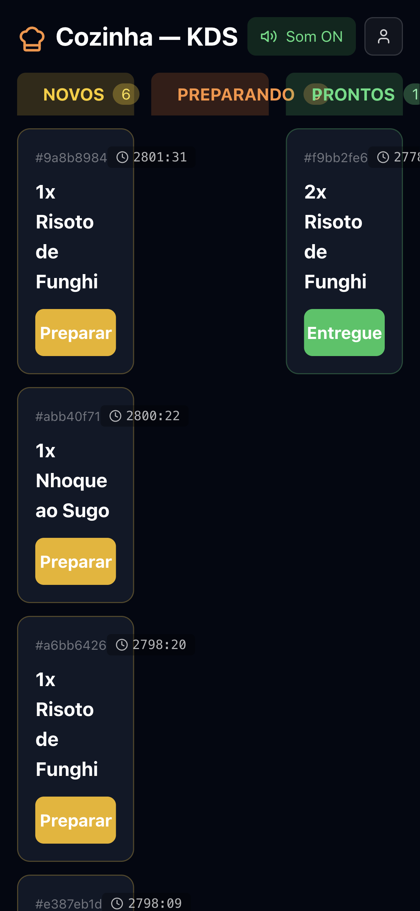

**Final URL:** `http://localhost:3002/cozinha`  
**Title:** `🐴 Restaurant SaaS — Staff`  
**Viewport:** 427x926  
**Visible clickables:** 9 (of 9 total)  
**Placebos:** 0

_Note: Viewport NOT scaled to 393x852 — page took a desktop-sized viewport (427x926). cozinha is presumably a kitchen-display surface designed for tablets/desktops, not mobile._

| Label | Tag | Handler? | Href | Status |
|---|---|---|---|---|
| Som ON | button | yes | - | real |
| Perfil | button | yes | - | real |
| Preparar | button | yes | - | real |
| Preparar | button | yes | - | real |
| Preparar | button | yes | - | real |
| Preparar | button | yes | - | real |
| Preparar | button | yes | - | real |
| Preparar | button | yes | - | real |
| Entregue | button | yes | - | real |

### customer-assistente

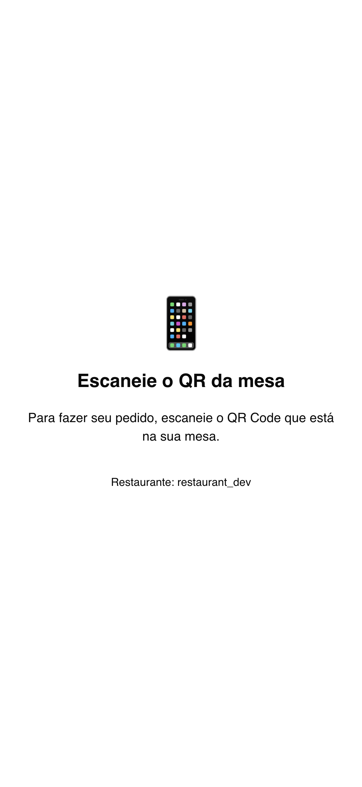

**Final URL:** `http://localhost:3003/restaurant_dev`  
**Title:** `Restaurant SaaS`  
**Viewport:** 393x852  
**Visible clickables:** 0 (of 0 total)  
**Placebos:** 0

_Note: Redirected to /restaurant_dev root with 'Escaneie o QR da mesa' placeholder because no customer session in localStorage. The route requires a prior session created via the QR flow._

_No interactive elements found (route may have redirected or shown empty/error state)._

### customer-cardapio

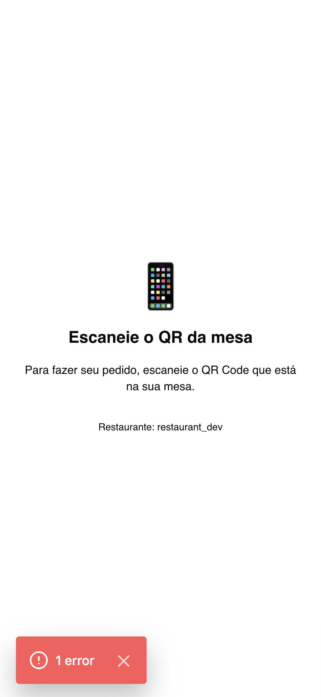

**Final URL:** `http://localhost:3003/restaurant_dev`  
**Title:** `Restaurant SaaS`  
**Viewport:** 393x852  
**Visible clickables:** 0 (of 0 total)  
**Placebos:** 0

_Note: Same redirect-to-root as customer-assistente — requires active customer session._

_No interactive elements found (route may have redirected or shown empty/error state)._

### customer-conta

**Final URL:** `http://localhost:3003/restaurant_dev/conta`  
**Title:** `🐴 404: This page could not be found.`  
**Viewport:** 393x852  
**Visible clickables:** 0 (of 0 total)  
**Placebos:** 0

_Note: 404. The route /restaurant_dev/conta does not exist (mobile shows '404: This page could not be found'). Either the customer Conta surface lives under a different URL (likely embedded in /mesa flow) or it has not been built._

_No interactive elements found (route may have redirected or shown empty/error state)._

### customer-mesa

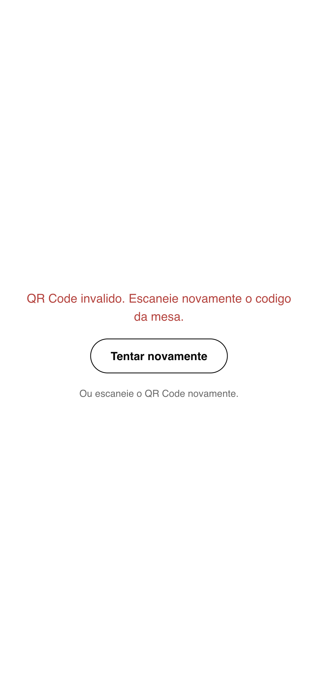

**Final URL:** `http://localhost:3003/restaurant_dev/mesa/M07`  
**Title:** `🐴 Restaurant SaaS`  
**Viewport:** 393x852  
**Visible clickables:** 1 (of 1 total)  
**Placebos:** 0

_Note: Page lands on error 'QR Code invalido' because we navigated directly without an HMAC-signed QR token (qr_hmac_secret in tables row). Real entry flow is via a QR scan that hits /mesa/[tableCode] with a `?t=<hmac>` parameter. Error UI itself is rendered correctly (CTA 'Tentar novamente' has handler)._

| Label | Tag | Handler? | Href | Status |
|---|---|---|---|---|
| Tentar novamente | button | yes | - | real |

### host-home

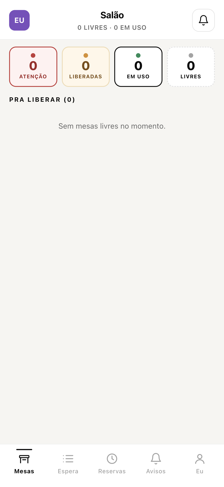

**Final URL:** `http://localhost:3002/host`  
**Title:** `🐴 Restaurant SaaS — Staff`  
**Viewport:** 393x852  
**Visible clickables:** 6 (of 6 total)  
**Placebos:** 1

| Label | Tag | Handler? | Href | Status |
|---|---|---|---|---|
| (no label) | button | no | - | placebo |
| Mesas | button | yes | - | real |
| Espera | button | yes | - | real |
| Reservas | button | yes | - | real |
| Avisos | button | yes | - | real |
| Eu | button | yes | - | real |

### host-profile

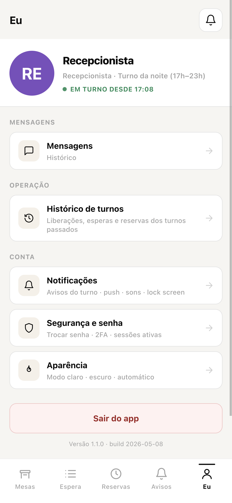

**Final URL:** `http://localhost:3002/host/profile`  
**Title:** `🐴 Restaurant SaaS — Staff`  
**Viewport:** 393x852  
**Visible clickables:** 12 (of 12 total)  
**Placebos:** 5

| Label | Tag | Handler? | Href | Status |
|---|---|---|---|---|
| Notificações | button | no | - | placebo |
| MensagensHistórico | button | yes | - | real |
| Histórico de turnosLiberações, esperas e reservas ... | button | no | - | placebo |
| NotificaçõesAvisos do turno · push · sons · lock s... | button | no | - | placebo |
| Segurança e senhaTrocar senha · 2FA · sessões ativ... | button | no | - | placebo |
| AparênciaModo claro · escuro · automático | button | no | - | placebo |
| Sair do app | button | yes | - | real |
| Mesas | button | yes | - | real |
| Espera | button | yes | - | real |
| Reservas | button | yes | - | real |
| Avisos | button | yes | - | real |
| Eu | button | yes | - | real |

### host-reservations

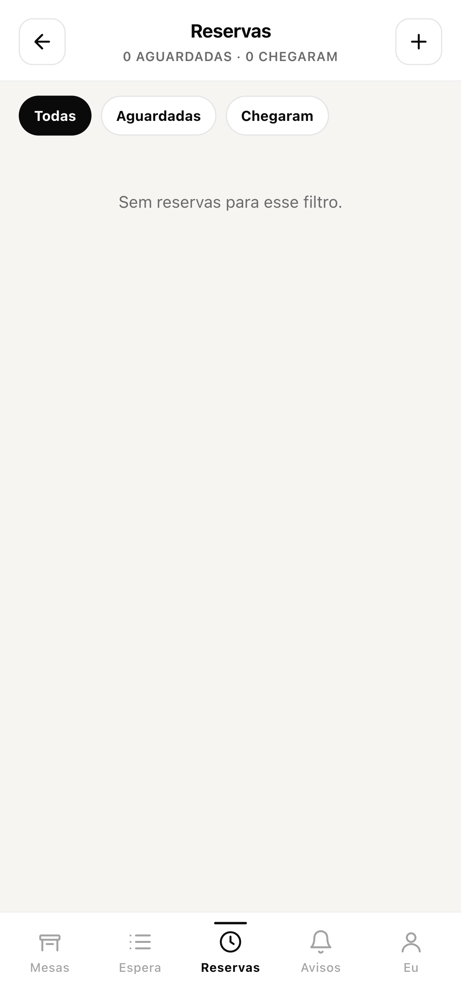

**Final URL:** `http://localhost:3002/host/reservations`  
**Title:** `🐴 Restaurant SaaS — Staff`  
**Viewport:** 393x852  
**Visible clickables:** 10 (of 10 total)  
**Placebos:** 0

| Label | Tag | Handler? | Href | Status |
|---|---|---|---|---|
| Voltar | button | yes | - | real |
| Adicionar | button | yes | - | real |
| Todas | button | yes | - | real |
| Aguardadas | button | yes | - | real |
| Chegaram | button | yes | - | real |
| Mesas | button | yes | - | real |
| Espera | button | yes | - | real |
| Reservas | button | yes | - | real |
| Avisos | button | yes | - | real |
| Eu | button | yes | - | real |

### host-swap

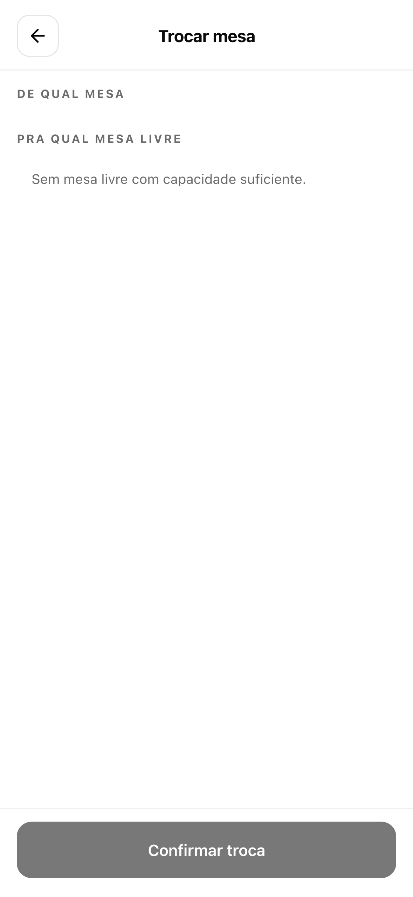

**Final URL:** `http://localhost:3002/host/swap`  
**Title:** `🐴 Restaurant SaaS — Staff`  
**Viewport:** 393x852  
**Visible clickables:** 2 (of 2 total)  
**Placebos:** 0

| Label | Tag | Handler? | Href | Status |
|---|---|---|---|---|
| Voltar | button | yes | - | real |
| Confirmar troca | button | yes | - | disabled |

### host-waitlist

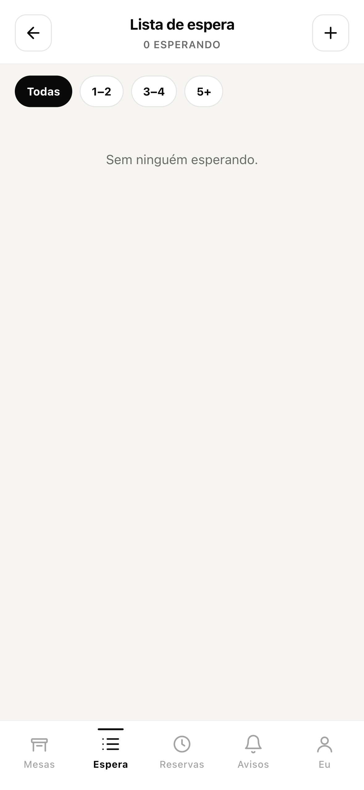

**Final URL:** `http://localhost:3002/host/waitlist`  
**Title:** `🐴 Restaurant SaaS — Staff`  
**Viewport:** 393x852  
**Visible clickables:** 11 (of 11 total)  
**Placebos:** 0

| Label | Tag | Handler? | Href | Status |
|---|---|---|---|---|
| Voltar | button | yes | - | real |
| Adicionar | button | yes | - | real |
| Todas | button | yes | - | real |
| 1–2 | button | yes | - | real |
| 3–4 | button | yes | - | real |
| 5+ | button | yes | - | real |
| Mesas | button | yes | - | real |
| Espera | button | yes | - | real |
| Reservas | button | yes | - | real |
| Avisos | button | yes | - | real |
| Eu | button | yes | - | real |

### manager-alertas

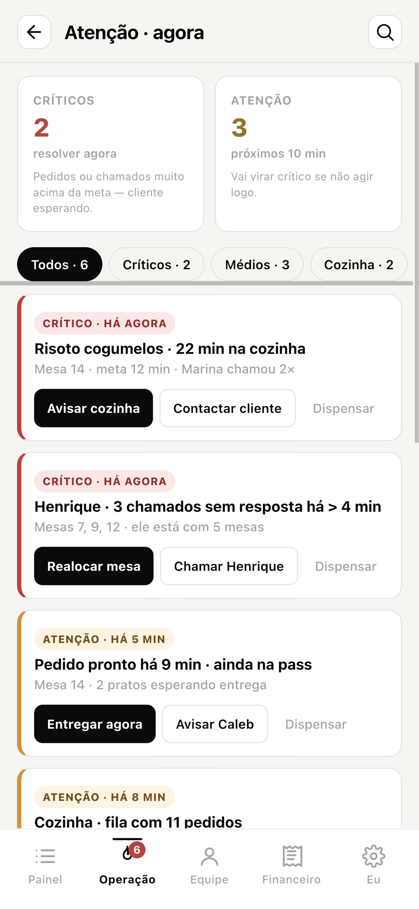

**Final URL:** `http://localhost:3002/manager/alertas`  
**Title:** `🐴 Restaurant SaaS — Staff`  
**Viewport:** 393x852  
**Visible clickables:** 29 (of 29 total)  
**Placebos:** 0

| Label | Tag | Handler? | Href | Status |
|---|---|---|---|---|
| Voltar | button | yes | - | real |
| Buscar | button | yes | - | real |
| Todos · 6 | button | yes | - | real |
| Críticos · 2 | button | yes | - | real |
| Médios · 3 | button | yes | - | real |
| Cozinha · 2 | button | yes | - | real |
| Avisar cozinha | button | yes | - | real |
| Contactar cliente | button | yes | - | real |
| Dispensar | button | yes | - | real |
| Realocar mesa | button | yes | - | real |
| Chamar Henrique | button | yes | - | real |
| Dispensar | button | yes | - | real |
| Entregar agora | button | yes | - | real |
| Avisar Caleb | button | yes | - | real |
| Dispensar | button | yes | - | real |
| Pausar pedidos | button | yes | - | real |
| Ver fila | button | yes | - | real |
| Dispensar | button | yes | - | real |
| Levar maquininha | button | yes | - | real |
| Pagar pelo app | button | yes | - | real |
| Dispensar | button | yes | - | real |
| Avisar bar | button | yes | - | real |
| Esconder do menu | button | yes | - | real |
| Dispensar | button | yes | - | real |
| Painel | button | yes | - | real |
| 6Operação | button | yes | - | real |
| Equipe | button | yes | - | real |
| Financeiro | button | yes | - | real |
| Eu | button | yes | - | real |

### manager-compensate

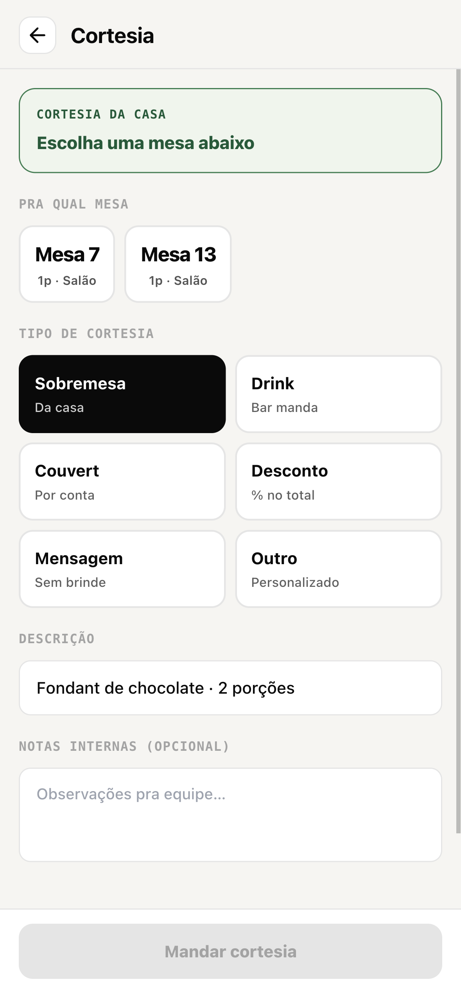

**Final URL:** `http://localhost:3002/manager/compensate`  
**Title:** `🐴 Restaurant SaaS — Staff`  
**Viewport:** 393x852  
**Visible clickables:** 10 (of 10 total)  
**Placebos:** 0

| Label | Tag | Handler? | Href | Status |
|---|---|---|---|---|
| Voltar | button | yes | - | real |
| Mesa 71p · Salão | button | yes | - | real |
| Mesa 131p · Salão | button | yes | - | real |
| SobremesaDa casa | button | yes | - | real |
| DrinkBar manda | button | yes | - | real |
| CouvertPor conta | button | yes | - | real |
| Desconto% no total | button | yes | - | real |
| MensagemSem brinde | button | yes | - | real |
| OutroPersonalizado | button | yes | - | real |
| Mandar cortesia | button | yes | - | disabled |

### manager-configuracoes

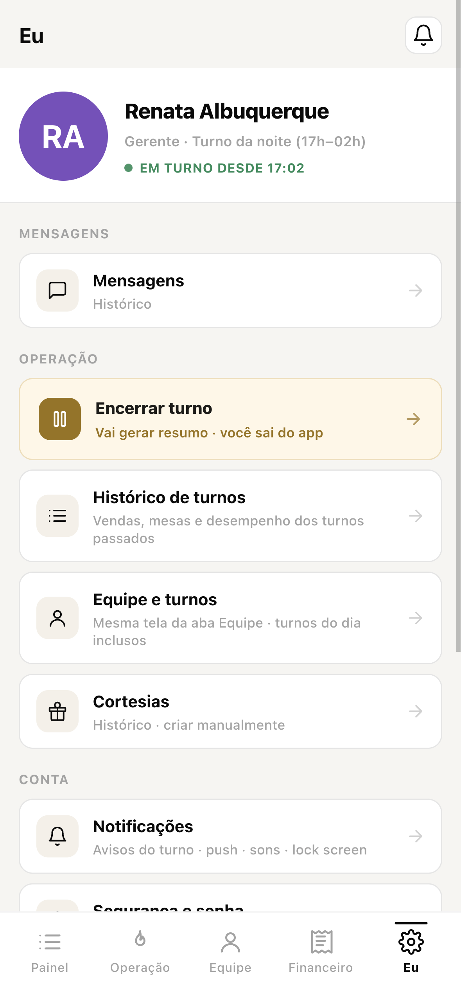

**Final URL:** `http://localhost:3002/manager/configuracoes`  
**Title:** `🐴 Restaurant SaaS — Staff`  
**Viewport:** 393x852  
**Visible clickables:** 15 (of 15 total)  
**Placebos:** 1

| Label | Tag | Handler? | Href | Status |
|---|---|---|---|---|
| Notificações | button | no | - | placebo |
| MensagensHistórico | button | yes | - | real |
| Encerrar turnoVai gerar resumo · você sai do app | button | yes | - | real |
| Histórico de turnosVendas, mesas e desempenho dos ... | button | yes | - | real |
| Equipe e turnosMesma tela da aba Equipe · turnos d... | button | yes | - | real |
| CortesiasHistórico · criar manualmente | button | yes | - | real |
| NotificaçõesAvisos do turno · push · sons · lock s... | button | yes | - | real |
| Segurança e senhaTrocar senha · 2FA · sessões ativ... | button | yes | - | real |
| AparênciaModo claro · escuro · automático | button | yes | - | real |
| Sair do app | button | yes | - | real |
| Painel | button | yes | - | real |
| Operação | button | yes | - | real |
| Equipe | button | yes | - | real |
| Financeiro | button | yes | - | real |
| Eu | button | yes | - | real |

### manager-cortesias-history

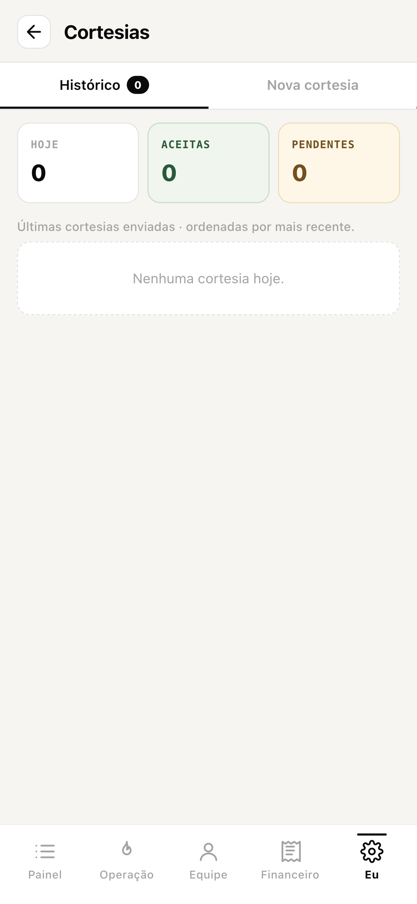

**Final URL:** `http://localhost:3002/manager/cortesias?tab=history`  
**Title:** `🐴 Restaurant SaaS — Staff`  
**Viewport:** 393x852  
**Visible clickables:** 8 (of 8 total)  
**Placebos:** 0

| Label | Tag | Handler? | Href | Status |
|---|---|---|---|---|
| Voltar | button | yes | - | real |
| Histórico0 | button | yes | - | real |
| Nova cortesia | button | yes | - | real |
| Painel | button | yes | - | real |
| Operação | button | yes | - | real |
| Equipe | button | yes | - | real |
| Financeiro | button | yes | - | real |
| Eu | button | yes | - | real |

### manager-cortesias-new

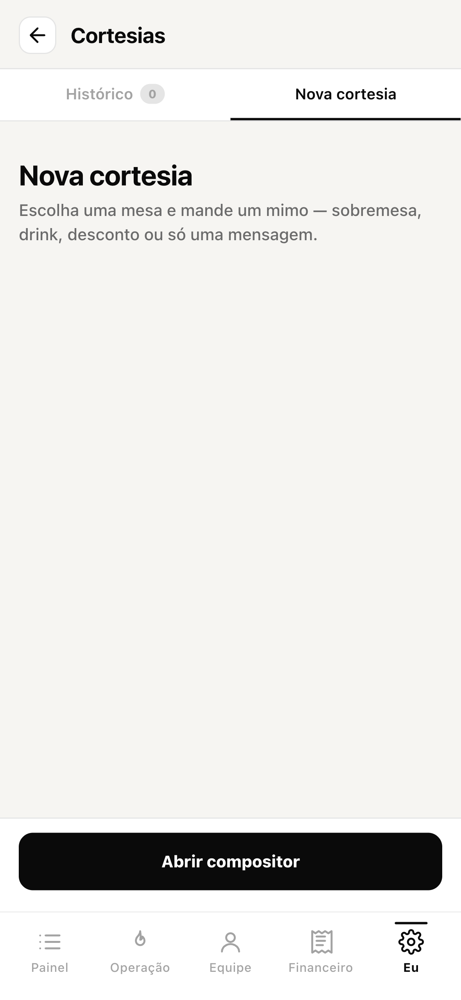

**Final URL:** `http://localhost:3002/manager/cortesias?tab=new`  
**Title:** `🐴 Restaurant SaaS — Staff`  
**Viewport:** 393x852  
**Visible clickables:** 9 (of 9 total)  
**Placebos:** 0

| Label | Tag | Handler? | Href | Status |
|---|---|---|---|---|
| Voltar | button | yes | - | real |
| Histórico0 | button | yes | - | real |
| Nova cortesia | button | yes | - | real |
| Abrir compositor | button | yes | - | real |
| Painel | button | yes | - | real |
| Operação | button | yes | - | real |
| Equipe | button | yes | - | real |
| Financeiro | button | yes | - | real |
| Eu | button | yes | - | real |

### manager-equipe

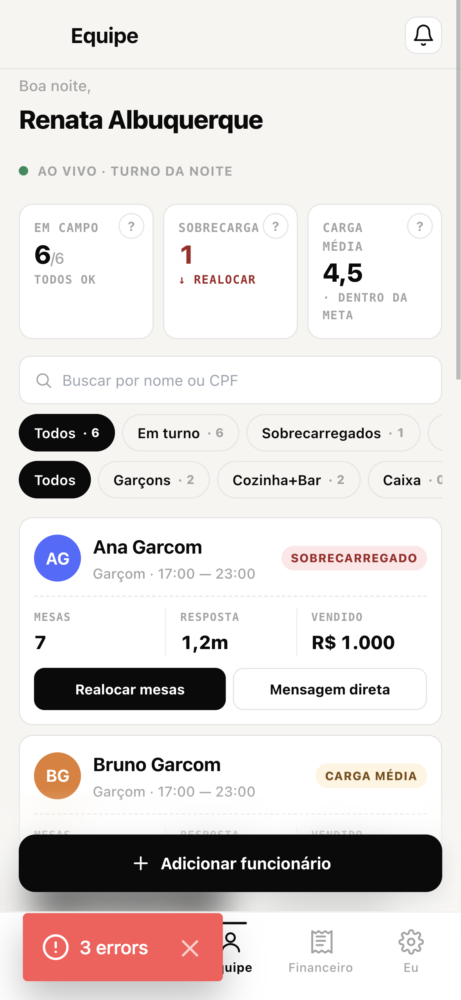

**Final URL:** `http://localhost:3002/manager/equipe`  
**Title:** `🐴 Restaurant SaaS — Staff`  
**Viewport:** 393x852  
**Visible clickables:** 44 (of 44 total)  
**Placebos:** 1

| Label | Tag | Handler? | Href | Status |
|---|---|---|---|---|
| Notificações | button | no | - | placebo |
| Em campo6/6 todos OK? | button | yes | - | real |
| ? | button | yes | - | real |
| Sobrecarga1 ↓ realocar? | button | yes | - | real |
| ? | button | yes | - | real |
| Carga média4,5 · DENTRO DA META? | button | yes | - | real |
| ? | button | yes | - | real |
| Todos· 6 | button | yes | - | real |
| Em turno· 6 | button | yes | - | real |
| Sobrecarregados· 1 | button | yes | - | real |
| Folga· 0 | button | yes | - | real |
| Fora· 0 | button | yes | - | real |
| Todos | button | yes | - | real |
| Garçons· 2 | button | yes | - | real |
| Cozinha+Bar· 2 | button | yes | - | real |
| Caixa· 0 | button | yes | - | real |
| AGAna GarcomGarçom · 17:00 — 23:00SobrecarregadoME... | div | yes | - | real |
| Realocar mesas | button | yes | - | real |
| Mensagem direta | button | yes | - | real |
| BGBruno GarcomGarçom · 17:00 — 23:00Carga médiaMES... | div | yes | - | real |
| Realocar mesas | button | yes | - | real |
| Mensagem direta | button | yes | - | real |
| CCCarlos CozinhaCozinheiro · 17:00 — 23:00Carga mé... | div | yes | - | real |
| Realocar mesas | button | yes | - | real |
| Mensagem direta | button | yes | - | real |
| DCDiana CozinhaCozinheiro · 17:00 — 23:00Em turnoM... | div | yes | - | real |
| Ver mesas | button | yes | - | real |
| Mover mesa | button | yes | - | real |
| EGErica Gerentemanager · 17:00 — 23:00Em turnoMESA... | div | yes | - | real |
| Ver mesas | button | yes | - | real |
| _...14 more elements truncated; raw data in /tmp/round18-json/manager-equipe.json.raw_ | | | | |

### manager-equipe-detail

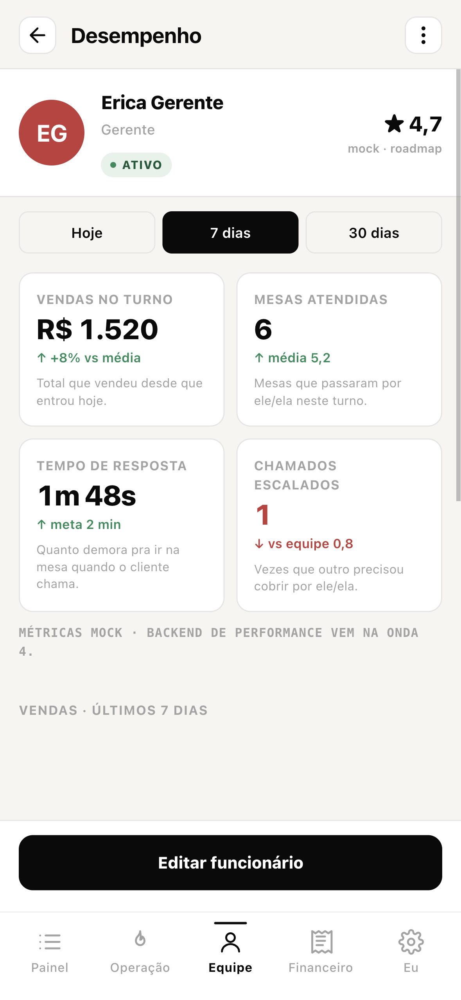

**Final URL:** `http://localhost:3002/manager/equipe/8bd06156-1fe5-4c18-a82d-43d38287ed4a`  
**Title:** `🐴 Restaurant SaaS — Staff`  
**Viewport:** 393x852  
**Visible clickables:** 11 (of 11 total)  
**Placebos:** 0

| Label | Tag | Handler? | Href | Status |
|---|---|---|---|---|
| Voltar | button | yes | - | real |
| Mais ações | button | yes | - | real |
| Hoje | button | yes | - | real |
| 7 dias | button | yes | - | real |
| 30 dias | button | yes | - | real |
| Editar funcionário | button | yes | - | real |
| Painel | button | yes | - | real |
| Operação | button | yes | - | real |
| Equipe | button | yes | - | real |
| Financeiro | button | yes | - | real |
| Eu | button | yes | - | real |

### manager-equipe-edit

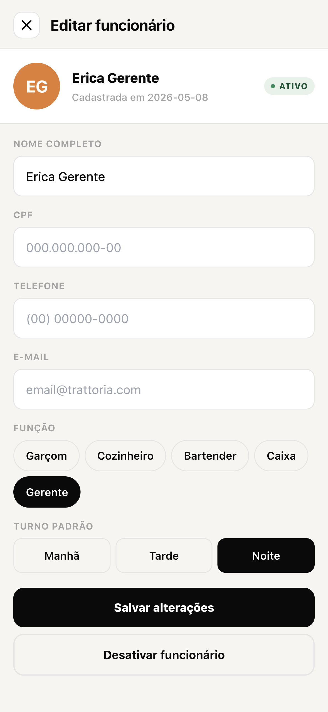

**Final URL:** `http://localhost:3002/manager/equipe/8bd06156-1fe5-4c18-a82d-43d38287ed4a/editar`  
**Title:** `🐴 Restaurant SaaS — Staff`  
**Viewport:** 393x852  
**Visible clickables:** 11 (of 11 total)  
**Placebos:** 0

| Label | Tag | Handler? | Href | Status |
|---|---|---|---|---|
| Fechar | button | yes | - | real |
| Garçom | button | yes | - | real |
| Cozinheiro | button | yes | - | real |
| Bartender | button | yes | - | real |
| Caixa | button | yes | - | real |
| Gerente | button | yes | - | real |
| Manhã | button | yes | - | real |
| Tarde | button | yes | - | real |
| Noite | button | yes | - | real |
| Salvar alterações | button | yes | - | real |
| Desativar funcionário | button | yes | - | real |

### manager-equipe-novo

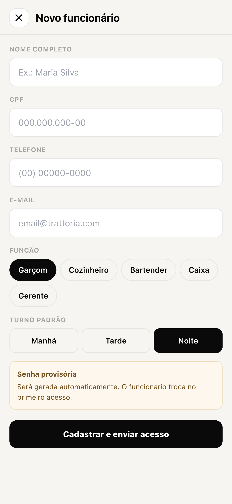

**Final URL:** `http://localhost:3002/manager/equipe/novo`  
**Title:** `🐴 Restaurant SaaS — Staff`  
**Viewport:** 393x852  
**Visible clickables:** 10 (of 10 total)  
**Placebos:** 0

| Label | Tag | Handler? | Href | Status |
|---|---|---|---|---|
| Fechar | button | yes | - | real |
| Garçom | button | yes | - | real |
| Cozinheiro | button | yes | - | real |
| Bartender | button | yes | - | real |
| Caixa | button | yes | - | real |
| Gerente | button | yes | - | real |
| Manhã | button | yes | - | real |
| Tarde | button | yes | - | real |
| Noite | button | yes | - | real |
| Cadastrar e enviar acesso | button | yes | - | real |

### manager-equipe-turnos

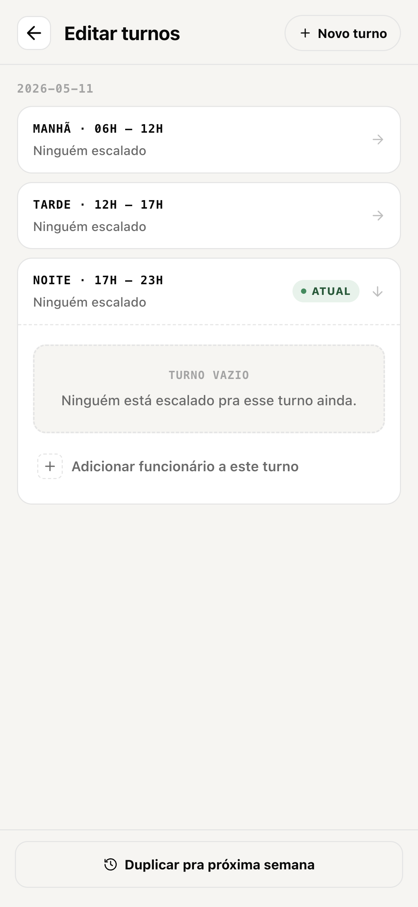

**Final URL:** `http://localhost:3002/manager/equipe/turnos`  
**Title:** `🐴 Restaurant SaaS — Staff`  
**Viewport:** 393x852  
**Visible clickables:** 7 (of 7 total)  
**Placebos:** 0

| Label | Tag | Handler? | Href | Status |
|---|---|---|---|---|
| Voltar | button | yes | - | real |
| Novo turno | button | yes | - | real |
| MANHÃ · 06H – 12HNinguém escalado | button | yes | - | real |
| TARDE · 12H – 17HNinguém escalado | button | yes | - | real |
| NOITE · 17H – 23HNinguém escaladoAtual | button | yes | - | real |
| Adicionar funcionário a este turno | button | yes | - | real |
| Duplicar pra próxima semana | button | yes | - | real |

### manager-financeiro

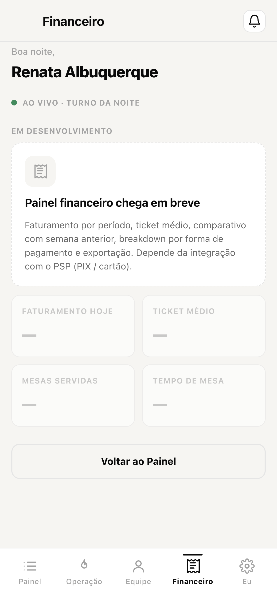

**Final URL:** `http://localhost:3002/manager/financeiro`  
**Title:** `🐴 Restaurant SaaS — Staff`  
**Viewport:** 393x852  
**Visible clickables:** 7 (of 7 total)  
**Placebos:** 1

| Label | Tag | Handler? | Href | Status |
|---|---|---|---|---|
| Notificações | button | no | - | placebo |
| Voltar ao Painel | button | yes | - | real |
| Painel | button | yes | - | real |
| Operação | button | yes | - | real |
| Equipe | button | yes | - | real |
| Financeiro | button | yes | - | real |
| Eu | button | yes | - | real |

### manager-home

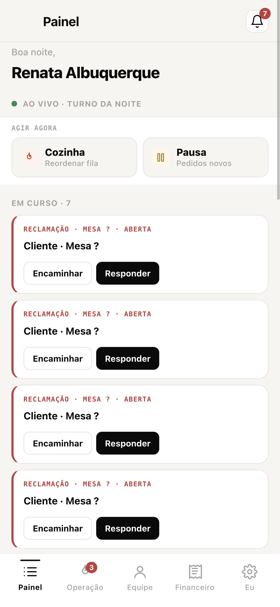

**Final URL:** `http://localhost:3002/manager`  
**Title:** `🐴 Restaurant SaaS — Staff`  
**Viewport:** 393x852  
**Visible clickables:** 41 (of 41 total)  
**Placebos:** 1

| Label | Tag | Handler? | Href | Status |
|---|---|---|---|---|
| 7 | button | no | - | placebo |
| CozinhaReordenar fila | button | yes | - | real |
| PausaPedidos novos | button | yes | - | real |
| RECLAMAÇÃO · MESA ? · ABERTACliente · Mesa ?Encami... | div | yes | - | real |
| Encaminhar | button | yes | - | real |
| Responder | button | yes | - | real |
| RECLAMAÇÃO · MESA ? · ABERTACliente · Mesa ?Encami... | div | yes | - | real |
| Encaminhar | button | yes | - | real |
| Responder | button | yes | - | real |
| RECLAMAÇÃO · MESA ? · ABERTACliente · Mesa ?Encami... | div | yes | - | real |
| Encaminhar | button | yes | - | real |
| Responder | button | yes | - | real |
| RECLAMAÇÃO · MESA ? · ABERTACliente · Mesa ?Encami... | div | yes | - | real |
| Encaminhar | button | yes | - | real |
| Responder | button | yes | - | real |
| JUNÇÃO DE MESAS · MESA ?Cliente · Mesa ?Aguarda ho... | div | yes | - | real |
| Ver detalhes | button | yes | - | real |
| JUNÇÃO DE MESAS · MESA ?Cliente · Mesa ?Aguarda ho... | div | yes | - | real |
| Ver detalhes | button | yes | - | real |
| JUNÇÃO DE MESAS · MESA ?Cliente · Mesa ?Aguarda ho... | div | yes | - | real |
| Ver detalhes | button | yes | - | real |
| Ver todos → | button | yes | - | real |
| Dispensar | button | yes | - | real |
| Avisar cozinha | button | yes | - | real |
| Contactar cliente | button | yes | - | real |
| Dispensar | button | yes | - | real |
| Realocar mesa | button | yes | - | real |
| Chamar garçom | button | yes | - | real |
| Dispensar | button | yes | - | real |
| Entregar agora | button | yes | - | real |
| _...11 more elements truncated; raw data in /tmp/round18-json/manager-home.json.raw_ | | | | |

### manager-kitchen-reorder

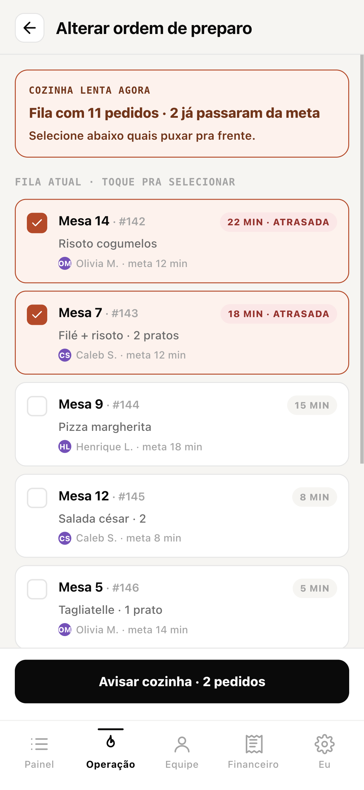

**Final URL:** `http://localhost:3002/manager/kitchen-reorder`  
**Title:** `🐴 Restaurant SaaS — Staff`  
**Viewport:** 393x852  
**Visible clickables:** 12 (of 12 total)  
**Placebos:** 0

| Label | Tag | Handler? | Href | Status |
|---|---|---|---|---|
| Voltar | button | yes | - | real |
| Mesa 14 · #14222 min · atrasadaRisoto cogumelosOMO... | button | yes | - | real |
| Mesa 7 · #14318 min · atrasadaFilé + risoto · 2 pr... | button | yes | - | real |
| Mesa 9 · #14415 minPizza margheritaHLHenrique L. ·... | button | yes | - | real |
| Mesa 12 · #1458 minSalada césar · 2CSCaleb S. · me... | button | yes | - | real |
| Mesa 5 · #1465 minTagliatelle · 1 pratoOMOlivia M.... | button | yes | - | real |
| Avisar cozinha · 2 pedidos | button | yes | - | real |
| Painel | button | yes | - | real |
| Operação | button | yes | - | real |
| Equipe | button | yes | - | real |
| Financeiro | button | yes | - | real |
| Eu | button | yes | - | real |

### manager-mensagens

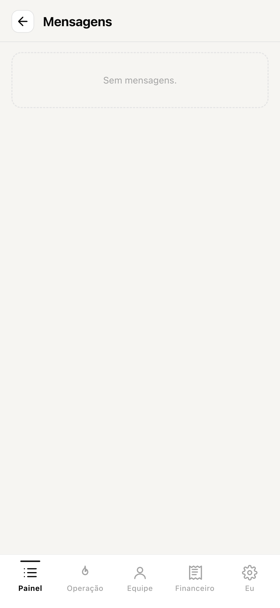

**Final URL:** `http://localhost:3002/manager/mensagens`  
**Title:** `🐴 Restaurant SaaS — Staff`  
**Viewport:** 393x852  
**Visible clickables:** 6 (of 6 total)  
**Placebos:** 0

| Label | Tag | Handler? | Href | Status |
|---|---|---|---|---|
| Voltar | button | yes | - | real |
| Painel | button | yes | - | real |
| Operação | button | yes | - | real |
| Equipe | button | yes | - | real |
| Financeiro | button | yes | - | real |
| Eu | button | yes | - | real |

### manager-mesa-7

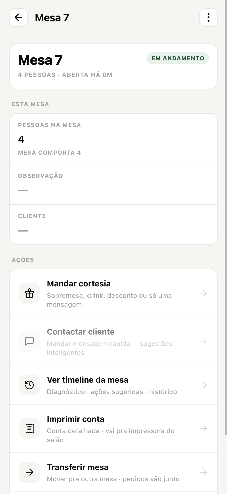

**Final URL:** `http://localhost:3002/manager/table-menu/bcd514ef-756f-4e45-8297-14723e9379ba?slug=restaurant_dev&tableNumber=7`  
**Title:** `Restaurant SaaS — Staff`  
**Viewport:** 393x852  
**Visible clickables:** 8 (of 8 total)  
**Placebos:** 0

_Note: Routed via redirect to /manager/table-menu/<sessionId>?slug=...&tableNumber=7 — the integer `7` was resolved to M07's active session. Behaves as expected._

| Label | Tag | Handler? | Href | Status |
|---|---|---|---|---|
| Voltar | button | yes | - | real |
| Mais ações | button | yes | - | real |
| Mandar cortesiaSobremesa, drink, desconto ou só um... | button | yes | - | real |
| Contactar clienteMandar mensagem rápida — sugestõe... | button | yes | - | disabled |
| Ver timeline da mesaDiagnóstico · ações sugeridas ... | button | yes | - | real |
| Imprimir contaConta detalhada · vai pra impressora... | button | yes | - | real |
| Transferir mesaMover pra outra mesa · pedidos vão ... | button | yes | - | real |
| Fechar mesaEncerra a sessão · só com conta paga | button | yes | - | real |

### manager-operacoes-alerts

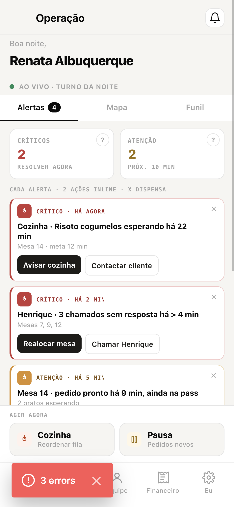

**Final URL:** `http://localhost:3002/manager/operacoes?tab=alerts`  
**Title:** `🐴 Restaurant SaaS — Staff`  
**Viewport:** 393x852  
**Visible clickables:** 27 (of 27 total)  
**Placebos:** 1

| Label | Tag | Handler? | Href | Status |
|---|---|---|---|---|
| Notificações | button | no | - | placebo |
| Alertas4 | button | yes | - | real |
| Mapa | button | yes | - | real |
| Funil | button | yes | - | real |
| Críticos2 resolver agora? | button | yes | - | real |
| ? | button | yes | - | real |
| Atenção2 próx. 10 min? | button | yes | - | real |
| ? | button | yes | - | real |
| Dispensar alerta | button | yes | - | real |
| Avisar cozinha | button | yes | - | real |
| Contactar cliente | button | yes | - | real |
| Dispensar alerta | button | yes | - | real |
| Realocar mesa | button | yes | - | real |
| Chamar Henrique | button | yes | - | real |
| Dispensar alerta | button | yes | - | real |
| Entregar agora | button | yes | - | real |
| Avisar Caleb | button | yes | - | real |
| Dispensar alerta | button | yes | - | real |
| Pausar pedidos | button | yes | - | real |
| Ver fila | button | yes | - | real |
| CozinhaReordenar fila | button | yes | - | real |
| PausaPedidos novos | button | yes | - | real |
| Painel | button | yes | - | real |
| 4Operação | button | yes | - | real |
| Equipe | button | yes | - | real |
| Financeiro | button | yes | - | real |
| Eu | button | yes | - | real |

### manager-operacoes-funnel

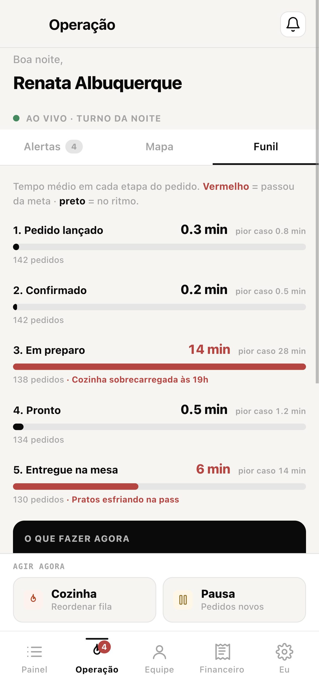

**Final URL:** `http://localhost:3002/manager/operacoes?tab=funnel`  
**Title:** `🐴 Restaurant SaaS — Staff`  
**Viewport:** 393x852  
**Visible clickables:** 11 (of 11 total)  
**Placebos:** 1

| Label | Tag | Handler? | Href | Status |
|---|---|---|---|---|
| Notificações | button | no | - | placebo |
| Alertas4 | button | yes | - | real |
| Mapa | button | yes | - | real |
| Funil | button | yes | - | real |
| CozinhaReordenar fila | button | yes | - | real |
| PausaPedidos novos | button | yes | - | real |
| Painel | button | yes | - | real |
| 4Operação | button | yes | - | real |
| Equipe | button | yes | - | real |
| Financeiro | button | yes | - | real |
| Eu | button | yes | - | real |

### manager-operacoes-map

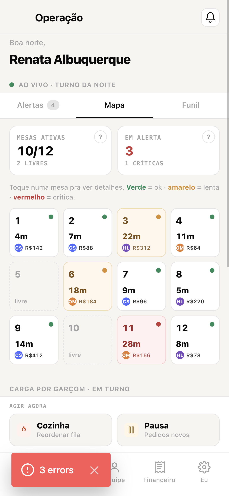

**Final URL:** `http://localhost:3002/manager/operacoes?tab=map`  
**Title:** `🐴 Restaurant SaaS — Staff`  
**Viewport:** 393x852  
**Visible clickables:** 25 (of 25 total)  
**Placebos:** 1

| Label | Tag | Handler? | Href | Status |
|---|---|---|---|---|
| Notificações | button | no | - | placebo |
| Alertas4 | button | yes | - | real |
| Mapa | button | yes | - | real |
| Funil | button | yes | - | real |
| Mesas ativas10/12 2 livres? | button | yes | - | real |
| ? | button | yes | - | real |
| Em alerta3 1 críticas? | button | yes | - | real |
| ? | button | yes | - | real |
| 14mCSR$142 | button | yes | - | real |
| 27mCSR$88 | button | yes | - | real |
| 322mHLR$312 | button | yes | - | real |
| 411mOMR$64 | button | yes | - | real |
| 618mOMR$184 | button | yes | - | real |
| 79mCSR$96 | button | yes | - | real |
| 85mHLR$220 | button | yes | - | real |
| 914mCSR$412 | button | yes | - | real |
| 1128mOMR$156 | button | yes | - | real |
| 128mHLR$78 | button | yes | - | real |
| CozinhaReordenar fila | button | yes | - | real |
| PausaPedidos novos | button | yes | - | real |
| Painel | button | yes | - | real |
| 4Operação | button | yes | - | real |
| Equipe | button | yes | - | real |
| Financeiro | button | yes | - | real |
| Eu | button | yes | - | real |

### manager-pausa-zona

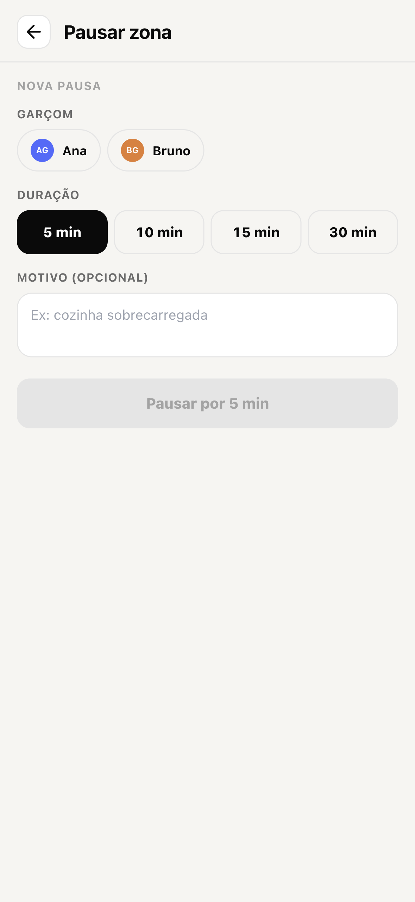

**Final URL:** `http://localhost:3002/manager/pausa-zona`  
**Title:** `🐴 Restaurant SaaS — Staff`  
**Viewport:** 393x852  
**Visible clickables:** 8 (of 8 total)  
**Placebos:** 0

| Label | Tag | Handler? | Href | Status |
|---|---|---|---|---|
| Voltar | button | yes | - | real |
| AGAna | button | yes | - | real |
| BGBruno | button | yes | - | real |
| 5 min | button | yes | - | real |
| 10 min | button | yes | - | real |
| 15 min | button | yes | - | real |
| 30 min | button | yes | - | real |
| Pausar por 5 min | button | yes | - | disabled |

### manager-timeline

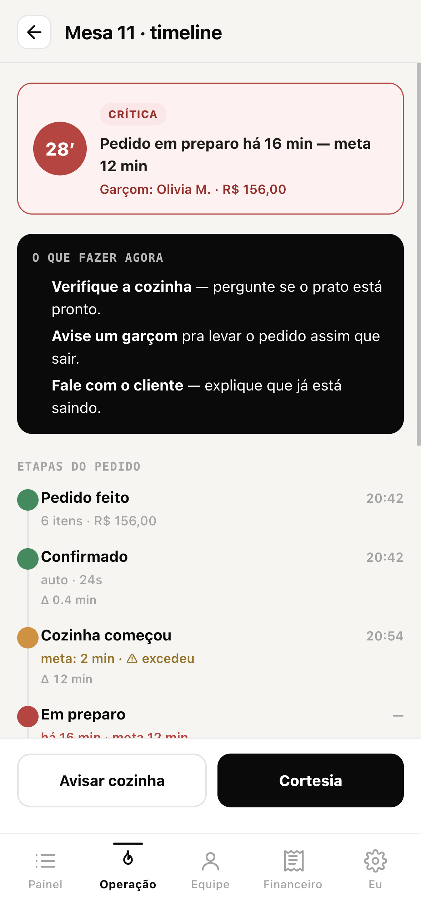

**Final URL:** `http://localhost:3002/manager/timeline/order-1`  
**Title:** `🐴 Restaurant SaaS — Staff`  
**Viewport:** 393x852  
**Visible clickables:** 8 (of 8 total)  
**Placebos:** 0

| Label | Tag | Handler? | Href | Status |
|---|---|---|---|---|
| Voltar | button | yes | - | real |
| Avisar cozinha | button | yes | - | real |
| Cortesia | button | yes | - | real |
| Painel | button | yes | - | real |
| Operação | button | yes | - | real |
| Equipe | button | yes | - | real |
| Financeiro | button | yes | - | real |
| Eu | button | yes | - | real |

### waiter-chamados

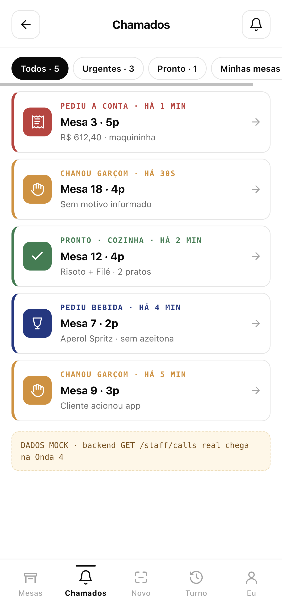

**Final URL:** `http://localhost:3002/waiter/chamados`  
**Title:** `🐴 Restaurant SaaS — Staff`  
**Viewport:** 393x852  
**Visible clickables:** 16 (of 16 total)  
**Placebos:** 1

| Label | Tag | Handler? | Href | Status |
|---|---|---|---|---|
| (no label) | button | yes | - | real |
| (no label) | button | no | - | placebo |
| Todos · 5 | button | yes | - | real |
| Urgentes · 3 | button | yes | - | real |
| Pronto · 1 | button | yes | - | real |
| Minhas mesas · 0 | button | yes | - | real |
| Pediu a conta · há 1 minMesa 3 · 5pR$ 612,40 · maq... | button | yes | - | real |
| Chamou garçom · há 30sMesa 18 · 4pSem motivo infor... | button | yes | - | real |
| Pronto · cozinha · há 2 minMesa 12 · 4pRisoto + Fi... | button | yes | - | real |
| Pediu bebida · há 4 minMesa 7 · 2pAperol Spritz · ... | button | yes | - | real |
| Chamou garçom · há 5 minMesa 9 · 3pCliente acionou... | button | yes | - | real |
| Mesas | button | yes | - | real |
| Chamados | button | yes | - | real |
| Novo | button | yes | - | real |
| Turno | button | yes | - | real |
| Eu | button | yes | - | real |

### waiter-eu

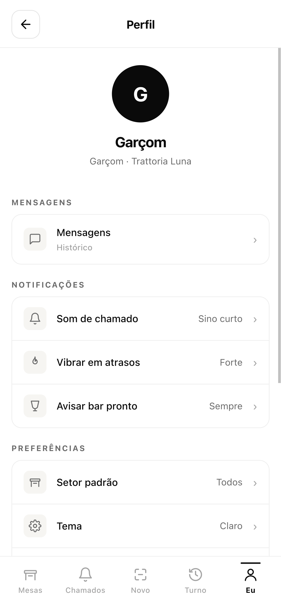

**Final URL:** `http://localhost:3002/waiter/eu`  
**Title:** `🐴 Restaurant SaaS — Staff`  
**Viewport:** 393x852  
**Visible clickables:** 9 (of 9 total)  
**Placebos:** 0

| Label | Tag | Handler? | Href | Status |
|---|---|---|---|---|
| Voltar | button | yes | - | real |
| MensagensHistórico› | button | yes | - | real |
| Encerrar turno› | button | yes | - | real |
| Sair da conta | button | yes | - | real |
| Mesas | button | yes | - | real |
| Chamados | button | yes | - | real |
| Novo | button | yes | - | real |
| Turno | button | yes | - | real |
| Eu | button | yes | - | real |

### waiter-home

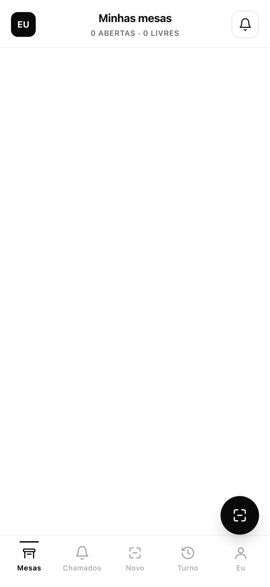

**Final URL:** `http://localhost:3002/waiter`  
**Title:** `🐴 Restaurant SaaS — Staff`  
**Viewport:** 393x852  
**Visible clickables:** 6 (of 7 total)  
**Placebos:** 1

| Label | Tag | Handler? | Href | Status |
|---|---|---|---|---|
| (no label) | button | no | - | placebo |
| Mesas | button | yes | - | real |
| Chamados | button | yes | - | real |
| Novo | button | yes | - | real |
| Turno | button | yes | - | real |
| Eu | button | yes | - | real |

### waiter-qr-issue

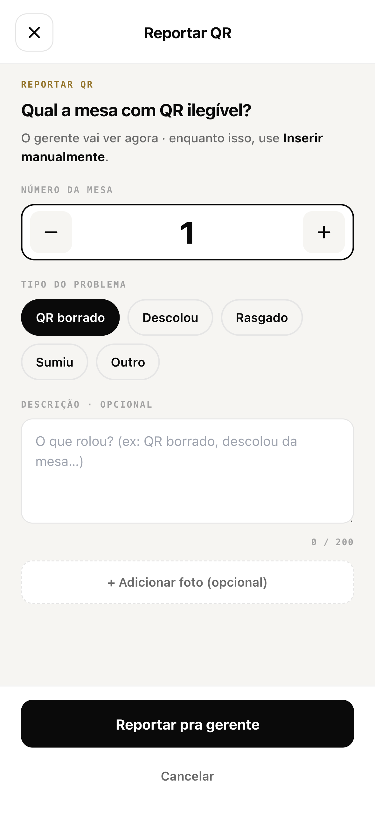

**Final URL:** `http://localhost:3002/waiter/qr-issue`  
**Title:** `🐴 Restaurant SaaS — Staff`  
**Viewport:** 393x852  
**Visible clickables:** 11 (of 11 total)  
**Placebos:** 0

| Label | Tag | Handler? | Href | Status |
|---|---|---|---|---|
| Fechar | button | yes | - | real |
| Diminuir | button | yes | - | real |
| Aumentar | button | yes | - | real |
| QR borrado | button | yes | - | real |
| Descolou | button | yes | - | real |
| Rasgado | button | yes | - | real |
| Sumiu | button | yes | - | real |
| Outro | button | yes | - | real |
| + Adicionar foto (opcional) | button | yes | - | real |
| Reportar pra gerente | button | yes | - | real |
| Cancelar | button | yes | - | real |

### waiter-scan-qr

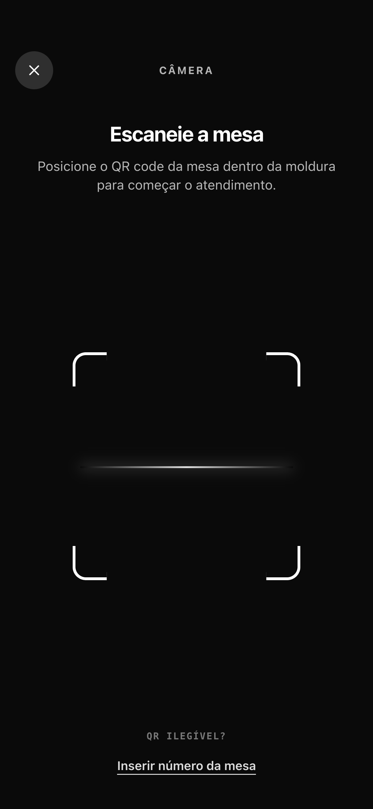

**Final URL:** `http://localhost:3002/waiter/scan-qr`  
**Title:** `🐴 Restaurant SaaS — Staff`  
**Viewport:** 393x852  
**Visible clickables:** 2 (of 2 total)  
**Placebos:** 0

| Label | Tag | Handler? | Href | Status |
|---|---|---|---|---|
| Fechar | button | yes | - | real |
| Inserir número da mesa | button | yes | - | real |
